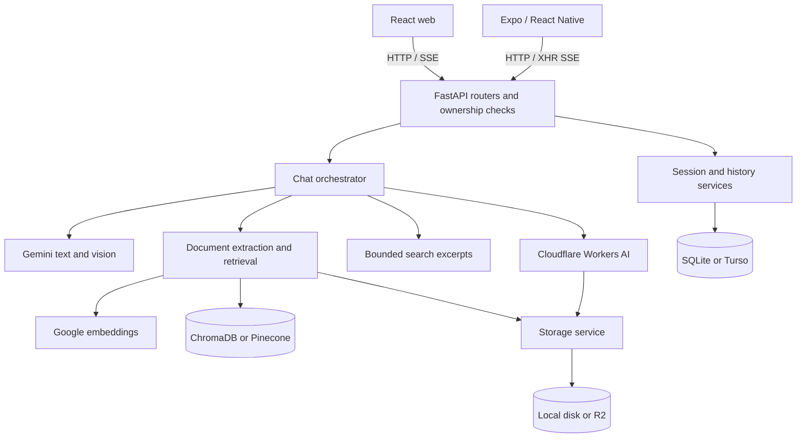

<div align="center">

# Contexify

**Multimodal AI Knowledge Engine & Assistant**

_Document Q&A, web search, image analysis, and image generation across web and mobile._

[](https://python.org)
[](https://fastapi.tiangolo.com)
[](https://react.dev)
[](https://reactnative.dev)
[](https://expo.dev)
[](https://ai.google.dev)
[](https://www.cloudflare.com/products/r2/)
[](https://turso.tech)
[](https://www.pinecone.io)
[](#license)

[Features](#key-features) | [Architecture](#system-architecture) | [Tech Stack](#tech-stack) | [Quick Start](#quick-start) | [Configuration](#environment-configuration) | [Testing](#automated-testing) | [Docker](#docker) | [Mobile & OTA](#mobile-deployment--over-the-air-ota-updates) | [Scripts](#available-scripts)

</div>

---

## Overview

Contexify combines document retrieval, conversational AI, web search, and image tools in a React web client and an Expo/React Native mobile app, backed by FastAPI.

The root, `frontend`, and `mobile` directories are separate npm packages, not npm workspaces. The root scripts coordinate them. SQL, vector, and file storage can use local or configured cloud services.

## Key Features

### Intelligent AUTO Mode & Intent Routing

- AUTO uses intent rules and relevant conversation/reply context to select a response path. Previously attached documents do not automatically become the source for unrelated questions.
- Choose an explicit mode when needed: `AUTO`, `DOCUMENT_RAG`, `WEB_SEARCH`, `MULTIMODAL`, or `IMAGE_GENERATION`.

### AI Image Generation & Media Studio

- Generate and edit images through Cloudflare Workers AI (currently FLUX.2 klein 4B), with image previews and downloads in the clients.
- Workers AI credentials are separate from R2 storage keys. Provider availability and quotas depend on the account; there is no Google Imagen or Pollinations fallback.

### Multimodal Vision & OCR

- Gemini analyzes uploaded images, including text visible in an image.
- Supported image uploads: PNG, JPEG, WebP, GIF, and BMP, subject to byte, dimension, frame, and concurrency limits. SVG and HEIC are not accepted.
- Mobile uses the system file picker for documents and images; it does not provide dedicated in-app camera capture.

### Web Search & Grounding

- Search answers use search/RSS excerpts with source links. Empty results and search failures are reported explicitly.
- The backend does not fetch full linked articles or independently verify their claims.

### Document RAG

- Upload PDF, TXT, MD, CSV, JSON, and LOG files. Text formats are read as text; PDFs use embedded text extraction. DOCX and automatic OCR for scanned PDFs are not supported.
- Retrieval selects bounded text chunks. An answer or whole-book summary is not guaranteed to include every page.

### Local & Cloud Storage

- Use SQLite or Turso for SQL, ChromaDB or Pinecone for vectors, and local disk or Cloudflare R2 for files.
- Signed-in users can reuse their library files across chats. Deleting a normal chat preserves library assets; deleting an item from the library removes that resource. Clearing messages preserves the chat's documents.

### Temporary Chat Mode

- Guest and temporary conversations have expiry-based retention, with startup/periodic cleanup and retries for external-store failures.
- These conversations are stored until expiry, rather than kept only in memory. See the retention details below.

### Native Mobile Application

- Expo/React Native clients provide chat, uploads, media previews, themes, and reply navigation.
- Recent messages load first; scrolling loads more history, and reply navigation fetches surrounding messages for older targets. Client windows and server context are bounded.

### Authentication & Profile Management

- Server-issued bearer credentials, server-side Google ID-token verification, ownership checks, authorized downloads, and email OTP flows protect account access.
- Passwords use PBKDF2-HMAC-SHA256 with per-user salts. OTP sends/resends and attempts have limits; this does not provide an application-wide API rate limiter.

### Theming & Web Experience

- Light/dark themes, session search/sorting/pinning, copy actions, image previews, and saved-message reply navigation.
- Both clients support basic text formatting. Full Markdown, KaTeX/LaTeX, and identical rendering across platforms are not provided.

### Storage, temporary chats, and privacy

- SQL stores users, credentials/session metadata, messages, citations, attachments, and lifecycle records in SQLite or Turso. Embeddings and chunk metadata use ChromaDB or Pinecone. File objects use local disk or R2.
- Guest and temporary conversations are stored with an expiry, **not kept only in memory or guaranteed never written to storage**. Their default conversation retention is three days (`TEMPORARY_CHAT_RETENTION_DAYS`). Guest access-token lifetime is a separate setting and does not promise access for the entire retention period.
- Expired/deleted temporary resources are cleaned by startup/periodic cleanup, with durable retries for external-store failures. Expiry does not guarantee immediate physical deletion while the backend is stopped or a provider is unavailable.
- Temporary chats are excluded from the normal signed-in history/library workflow. Normal-chat library retention is different from temporary-chat cleanup.
- Relevant prompts, document text, or images are sent to the configured AI/search services when a feature requires them. This project does not establish those providers' retention policies or offer a zero-storage/privacy certification.

## System Architecture



Dependencies and versions are recorded in `frontend/package-lock.json`, `mobile/package-lock.json`, and `backend/requirements.txt`. Model defaults and resource limits live in [config.py](backend/app/core/config.py); provider access and quota are not guaranteed by a configured model name.

The architecture and audit documents under [docs](docs/architecture.md) record an earlier source baseline. They are useful background, not a live implementation-completion tracker.

## Tech Stack

| Layer                     | Technologies                                          | Role                                               |
| ------------------------- | ----------------------------------------------------- | -------------------------------------------------- |
| Web frontend              | React 18, TypeScript, Vite, Tailwind CSS, React Icons | Browser UI and streamed responses                  |
| Mobile app                | React Native 0.86, React 19, Expo SDK 57, TypeScript  | Native chat, file picking, and device interactions |
| Backend API               | Python 3.11, FastAPI, Uvicorn, Pydantic               | API contracts, authorization, and SSE streaming    |
| Text, vision & embeddings | Google GenAI SDK                                      | Configured Gemini models and document embeddings   |
| Image generation          | Cloudflare Workers AI                                 | Image generation and reference edits               |
| SQL                       | SQLite / Turso                                        | Users, sessions, messages, and lifecycle records   |
| Vector search             | ChromaDB / Pinecone                                   | Embedding storage and chunk retrieval              |
| File storage              | Local disk / Cloudflare R2 via boto3                  | Documents, media, and avatars                      |
| Authentication & email    | Google sign-in, PBKDF2, Brevo / SMTP                  | Verified account access and OTP delivery           |

## Quick Start

### Requirements

- Python **3.11**, the runtime verified for the backend lockfile and Docker image.
- A Node.js version accepted by the `engines` fields in the package manifests. Node **22.13.0** was used for local checks; Docker uses a pinned Node 22 image. npm enforces the declared engine requirements through each package's `.npmrc`.
- Provider credentials for the features you want to use. Local SQLite/ChromaDB/file storage does **not** make AI generation, embeddings, email, or web search offline.
- For mobile testing, a compatible Expo Go installation or a development/native build and a reachable backend address.

### Windows (PowerShell)

```powershell
git clone https://github.com/Prats129/Contexify.git
cd Contexify
npm ci
npm run setup
npm run setup:mobile
Copy-Item backend/.env.example backend/.env
Copy-Item frontend/.env.example frontend/.env
Copy-Item mobile/.env.example mobile/.env
```

Copy templates only when creating a new setup; keep existing `.env` files when updating. Configure the copied files as described below before starting services. `npm run setup` installs the web dependencies and creates/installs the backend virtual environment; mobile setup is separate.

### macOS / Linux

The root backend/setup scripts use Windows virtual-environment paths. Use these explicit commands instead:

```sh
git clone https://github.com/Prats129/Contexify.git
cd Contexify
npm ci
npm ci --prefix frontend
npm ci --prefix mobile
python3.11 -m venv backend/venv
backend/venv/bin/python -m pip install --require-hashes -r backend/requirements.txt
cp backend/.env.example backend/.env
cp frontend/.env.example frontend/.env
cp mobile/.env.example mobile/.env
```

The shell paths above describe the POSIX equivalents; the complete bootstrap was not run on macOS. Linux Docker builds and isolated backend checks have been exercised.

## Environment Configuration

Use the tracked `.env.example` files as templates. Keep real credentials in ignored `.env` files locally or in the deployment platform's secret settings.

### Backend: `backend/.env`

A local storage setup selects:

```dotenv
DB_MODE=local
DATABASE_TYPE=
VECTOR_STORE_TYPE=
STORAGE_MODE=local
GEMINI_API_KEY=
GOOGLE_CLIENT_ID=
CLOUDFLARE_AI_ACCOUNT_ID=
CLOUDFLARE_AI_API_TOKEN=
```

Starting with local storage does not require cloud database/storage credentials. AI features report that they are unconfigured until their required credentials are provided.

| Setting                                               | Purpose                                                                                                                                                                                            |
| ----------------------------------------------------- | -------------------------------------------------------------------------------------------------------------------------------------------------------------------------------------------------- |
| `GEMINI_API_KEY`                                      | Google text generation, image analysis, and document embeddings.                                                                                                                                   |
| `DEFAULT_LLM_MODEL`, `FALLBACK_LLM_MODELS`            | Gemini text/vision models. Model fallback is bounded and does not restart an answer after partial output has already streamed.                                                                     |
| `DEFAULT_EMBEDDING_MODEL`, `EMBEDDING_DIMENSION`      | Embedding model and dimensionality; the default dimension is 768. Existing vectors must remain compatible with this embedding space; changing these settings is not an automatic vector migration. |
| `GOOGLE_CLIENT_ID`                                    | Expected Google credential audience for backend verification. Match the client configuration used by the apps.                                                                                     |
| `BREVO_*` / `SMTP_*`                                  | Email delivery for OTP/authentication flows. Brevo or SMTP must be configured for those flows; local storage is not a mail substitute.                                                             |
| `CLOUDFLARE_AI_ACCOUNT_ID`, `CLOUDFLARE_AI_API_TOKEN` | Workers AI image generation/editing. R2 S3 credentials cannot authenticate this API.                                                                                                               |
| `DB_MODE=cloud`                                       | Selects Turso and Pinecone unless explicitly overridden. Requires `TURSO_DATABASE_URL`, `TURSO_AUTH_TOKEN`, `PINECONE_API_KEY`, and `PINECONE_INDEX_NAME`.                                         |
| `DATABASE_TYPE`, `VECTOR_STORE_TYPE`                  | Optional explicit overrides: `sqlite`/`turso` and `chromadb`/`pinecone`. These allow intentional mixed local/cloud setups.                                                                         |
| `STORAGE_MODE=cloudflare`                             | Requires R2 access key, secret key, bucket name, and either account ID or endpoint URL.                                                                                                            |
| `DATA_DIR`                                            | Local SQL/vector/file storage root; defaults to `backend/data` outside Docker.                                                                                                                     |

Explicitly selected cloud backends fail startup when required settings are missing or R2 initialization fails; they do not silently switch to local disk. If `STORAGE_MODE` is omitted, existing R2 credential setups are retained, while a fresh setup without R2 credentials uses local disk. Partial R2 configuration is rejected.

Default document upload limits are 25 MiB and 2,000,000 extracted text characters. PDF parsing additionally bounds pages, execution time, memory, and parser concurrency. Chunk count and concurrent document ingestion are also limited. See `config.py` for the exact settings; a scanned, invalid, encrypted, oversized, or textless PDF may be rejected.

### Web: `frontend/.env`

```dotenv
# Leave empty for the Vite development proxy or same-origin Docker deployment.
VITE_API_BASE_URL=
# Optional Google sign-in; use a public OAuth client ID, not a secret.
VITE_GOOGLE_CLIENT_ID=
```

An explicit `VITE_API_BASE_URL` is the backend **origin**, such as `https://your-api.example.com`, without `/api/v1`; the client appends that path. Restart/rebuild Vite after changing these values. Configure backend CORS for a separate web origin and configure the web origin in Google OAuth when using Google sign-in.

### Mobile: `mobile/.env`

```dotenv
EXPO_PUBLIC_APP_ENV=development
# Example only: replace with the actual computer address reachable from your phone.
EXPO_PUBLIC_API_URL=http://192.168.1.50:8001
EXPO_PUBLIC_GOOGLE_CLIENT_ID=
```

A phone's `localhost` is the phone itself. The backend must listen on `0.0.0.0`, the phone must have a route to the computer, and the host firewall must allow the connection. Being connected through a phone hotspot does not itself prove that the app can reach the backend. Verify `http://<computer-address>:8001/api/v1/health` from the phone browser.

Development server settings are shown only when allowed by `mobile/src/config/env.ts`; production uses the configured backend URL. The fallback LAN address in `api.ts` is a development default, not network discovery. Set the real address explicitly and restart Expo after changing environment values.

Google sign-in has native and Expo Go/browser paths in `AuthModal.tsx`. OAuth configuration and native signing/client setup must match the chosen runtime; success in Expo Go is not evidence that a standalone build's Google sign-in is configured.

`VITE_*` and `EXPO_PUBLIC_*` settings are client-visible. Keep backend API keys, mail passwords, and storage secrets out of them. Expo documents how these values are [inlined into app bundles](https://docs.expo.dev/guides/environment-variables/).

## Running the Applications

On Windows, from the root:

```powershell
npm run dev       # Backend + web
npm run dev:all   # Backend + web + Expo
```

Or start services individually with `npm run backend`, `npm run frontend`, and `npm run mobile`. On macOS/Linux, start the backend in its own terminal using:

```sh
cd backend
venv/bin/python -m uvicorn app.main:app --reload --host 0.0.0.0 --port 8001
```

Start web/mobile in separate terminals using the root `frontend`/`mobile` scripts. The development addresses are:

- Web: `http://localhost:8000`
- API: `http://127.0.0.1:8001`
- API health: `http://127.0.0.1:8001/api/v1/health`
- Swagger: `http://127.0.0.1:8001/docs`

The mobile start command targets Expo Go. Use a native/development build when testing native-module behavior. Check Android and iOS behavior on their actual target runtimes; no universal performance or device-compatibility guarantee is implied.

## Automated Testing

The following regression suites use disposable databases/files, mocked providers, and no configured production services. Run from the repository root after installing backend, web, and mobile dependencies:

```powershell
backend/venv/Scripts/python.exe -B backend/tests/test_configuration.py
backend/venv/Scripts/python.exe -B backend/tests/test_api_contracts.py
backend/venv/Scripts/python.exe -B backend/tests/test_auth_security.py
backend/venv/Scripts/python.exe -B backend/tests/test_turso_http.py
node tests/auth_clients.test.cjs
node tests/chat_history_scroll.test.cjs
node tests/mobile_keyboard.test.cjs
node frontend/node_modules/typescript/bin/tsc --project frontend/tsconfig.json --noEmit --incremental false
node mobile/node_modules/typescript/bin/tsc --project mobile/tsconfig.json --noEmit --incremental false
```

On macOS/Linux, replace `backend/venv/Scripts/python.exe` with `backend/venv/bin/python`.

The older `backend/test_*.py` and `backend/verify_*.py` scripts are **not** the default isolated suite: they can use configured stores, send mail, or call providers. Inspect and isolate their configuration before using them. `reset_db.py` is destructive, not a health check or migration command.

These suites verify application behavior and mocked client events. They do not establish live provider availability, production capacity, physical-device keyboard behavior, Google OAuth console setup, or EAS deployment success. Test those separately in an appropriate environment.

### Updating dependencies

`backend/requirements.in` lists direct Python dependencies; `backend/requirements.txt` locks the complete dependency graph and download hashes. After intentionally editing `.in`, regenerate with the command recorded in the `.txt` header (uv 0.13.5 was used for the checked lock), then verify a clean install and the regressions. Do not hand-edit the generated hash list.

Use `npm install` in the relevant package when intentionally changing JavaScript dependencies, and commit its manifest and lockfile together. Normal setup uses `npm ci`, which replaces that package's installed dependencies with the locked versions and fails on manifest/lock inconsistencies.

### Updating API contracts

Backend Pydantic schemas are the source for both clients' generated `src/types/api-contracts.ts` files. After changing a schema, run `npm run contracts:generate`, then `npm run contracts:check` and both client type checks. These root commands use the Windows backend venv; on macOS/Linux, run `backend/venv/bin/python -B scripts/generate_api_contracts.py` (add `--check` to verify). The generator imports schemas only, without starting the app or accessing configured services. Keep optimistic message state and platform-specific callbacks in each client's `src/types/index.ts`.

## Docker

The root Dockerfile builds the web client and serves it with the Python API. Base image digests, npm lockfiles, and the hash-checked Python lockfile fix the selected images and package artifacts. This is not a promise of bit-for-bit image identity across every host or changing OS package repository.

```sh
docker build -t contexify .
# Explicit local storage example; AI/mail still need their own configuration.
docker run --rm -p 7860:7860 -e DB_MODE=local -e STORAGE_MODE=local -v contexify-data:/data contexify
```

The Dockerfile defaults to `DB_MODE=cloud`; without overrides, provide its required cloud credentials through runtime environment/secret settings. Use a persistent `/data` volume when relying on local stores. Do not switch a production storage mode as a substitute for migrating its data.

`VITE_GOOGLE_CLIENT_ID` and `VITE_API_BASE_URL` are public build arguments. Backend secrets belong at runtime, not in the Docker build context or browser bundle. `.dockerignore` excludes environments, private key/database files, dependencies, and caches.

## Mobile Deployment & Over-The-Air (OTA) Updates

The helpers invoke EAS and can create remote builds or publish updates. Configure your Expo project/account, app identifiers, signing/OAuth settings, backend target, and EAS environments before using them. Review the project-specific values in `mobile/app.json` and `mobile/eas.json`; availability, cost, and build duration depend on the service/account.

| Command                                          | Current target                                                                                                                 |
| ------------------------------------------------ | ------------------------------------------------------------------------------------------------------------------------------ |
| `npm run deploy:mobile`                          | Android APK, `preview` profile/channel.                                                                                        |
| `npm run deploy:mobile:bundle`                   | Android app bundle, `production` profile/channel.                                                                              |
| `npm run deploy:mobile:ios`                      | iOS build, `production` profile/channel; store distribution requires its own setup.                                            |
| `npm run update:mobile -- "Describe the change"` | Publish to the `preview` channel using the `preview` EAS environment. This command does not publish to the production channel. |

The helpers read `EXPO_PUBLIC_API_URL` from their environment and may override it from `mobile/.env`, so check the effective target before invoking them. The development profile uses a development client; preview is an internal APK; production is a separate channel.

OTA updates require a compatible native runtime and matching channel. They can update compatible JavaScript/assets; adding or changing native modules/configuration requires a new app build. This project uses the `appVersion` runtime policy: maintain the app version/runtime compatibility when making native changes. See Expo's [runtime-version guidance](https://docs.expo.dev/eas-update/runtime-versions/).

The SDK 58 upgrade uses app/runtime version `1.1.0` and requires a new native build or an SDK 58-compatible Expo Go installation. Do not publish this JavaScript bundle to an SDK 57 native runtime. Keep Expo-managed dependencies at the versions recommended by `npx expo install --check`; an independently newer native package may not match Expo Go.

With this project's on-load checks and zero cache-wait setting, updates can download for a subsequent restart; they are not guaranteed to apply immediately on launch or reach every installed app. See [expo-updates](https://docs.expo.dev/versions/latest/sdk/updates/). EAS commands were not executed as part of the offline regression checks.

## Repository Structure

```text
backend/
  app/api/v1/endpoints/     API routes
  app/core/                Settings, security, errors, async worker boundary
  app/db/                  SQL schema and SQLite/Turso adapter
  app/repositories/        Session cache and vector-store adapter
  app/schemas/             Request/response contracts
  app/services/            AI/search, ingestion, storage, auth, lifecycle services
  tests/                   Isolated backend regression suites
  requirements.in          Direct dependency pins
  requirements.txt         Generated dependency/hash lock
frontend/                  React web package
mobile/                    Expo/React Native package
scripts/                   EAS build/update helpers
tests/                     Offline web/native client regression suites
docs/                      Architecture and historical audit documents
Dockerfile                 Backend + built web client image
```

## Available Scripts

Root backend/setup commands use Windows paths as noted above.

| Command                  | Purpose                                                                                                                              |
| ------------------------ | ------------------------------------------------------------------------------------------------------------------------------------ |
| `npm run backend`        | FastAPI development server on port 8001.                                                                                             |
| `npm run frontend`       | Vite development server on port 8000.                                                                                                |
| `npm run mobile`         | Expo Go development server.                                                                                                          |
| `npm run dev`            | Backend and web concurrently.                                                                                                        |
| `npm run dev:all`        | Backend, web, and mobile concurrently.                                                                                               |
| `npm run build:frontend` | Type-check and build `frontend/dist`.                                                                                                |
| `npm run setup`          | Install locked frontend packages and prepare the Python venv.                                                                        |
| `npm run setup:backend`  | Create the venv and install hash-checked backend requirements.                                                                       |
| `npm run setup:mobile`   | Install locked mobile dependencies.                                                                                                  |
| `npm run db:reset`       | Destructive helper for configured vectors, uploads, and SQL records. Not a complete cross-store lifecycle cleanup or migration tool. |

Deployment commands are listed separately above. There are no root `dev:backend`, `dev:frontend`, or `dev:mobile` scripts.

## License

MIT is declared by this README. A separate `LICENSE` file is not currently tracked in the repository.
