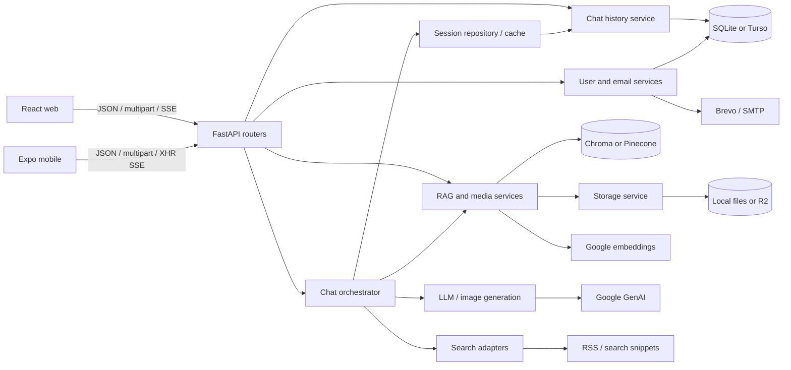

# Architecture

Source baseline and limits: [coverage](review-coverage.md). All issue details live in [technical findings](audit/technical-findings.md).

## Structure

This is one modular backend, not independent microservices. Global service/repository singletons are instantiated during imports. Repositories call services and some dependencies use deferred imports; the layers are not strictly one-way. No direct static import cycle was established, but startup coupling complicates isolated tests.

Web/native duplicate types, API facades, mode rules, password validation and session state. Web URL/history routing is implemented directly without React Router; native navigation uses component state, drawer and modals. User profiles and preferences are cached in localStorage/AsyncStorage. Cached identity data does not authenticate requests (AUD-001).

## Execution and protocols

main.py registers /api/v1/{health,user,session,document,media,chat}, docs, static media and optional built SPA. CORS is the sole middleware. Static delivery and SPA fallback need independent protection (AUD-004/AUD-031).

POST /chat/stream returns manually framed text/event-stream JSON: token, citations, media, error, done. Canonical SQL message IDs are not acknowledged to clients (AUD-028). Mobile frame buffering is broken (AUD-016).

Startup initializes/migrates SQL, purges expired temporary chats and starts a six-hour cleanup task. No external scheduler, durable queue or leader election exists. Multiple processes would each own a cache and cleanup task. Email/image operations use thread offloading; many other synchronous operations run in async request paths (AUD-013).

## Relational model

| Table | Relationships | Stored data |
| --- | --- | --- |
| users | id PK; username/email unique | name, salted PBKDF2 hash, avatar, creation timestamp |
| chat_sessions | user_id non-null FK → users, cascade delete | title, mode, temporary/expiry, pin, timestamps |
| messages | session_id FK → sessions, cascade | content/role; JSON citations, attachments, reply reference |
| documents | session_id non-null FK → sessions, cascade; nullable user_id without FK | filename/type/size/chunk count/storage URL |
| media_assets | nullable session_id FK → sessions, cascade; nullable user_id without FK | path/URL/MIME/size, upload/generated origin, prompt |
| email_otps | email text; no purpose/user FK | plaintext code, expiry, attempts, used flag |

[database.py:init_db](../backend/app/db/database.py) creates tables/indexes and performs column-presence ALTER checks. No versioned migration/rollback history exists. SQLite enables FK/WAL per connection. Turso suppresses those PRAGMAs and commit/rollback are no-ops; cloud atomicity and FK behavior require separate validation (AUD-010).

Values are normally parameterized; dynamic sorting selects fixed SQL fragments. Session lists exclude temporary rows, search titles with LIKE, sort pinned first then creation date, and count related messages/documents. Indexes cover common user/session/created/expiry filters. Full message history is fetched without pagination. No query plans, cardinalities or load measurements were available.

JSON reply/attachment relationships are not database-enforced. SQL, vectors and raw storage are independently mutated without a cross-store transaction. Cascade deletion only covers relational rows, not external bytes (AUD-007/AUD-021).

## Retrieval and integrations

Upload → temporary/raw file → PDF or UTF-8 text extraction → recursive character chunking → batch embeddings → vector upsert → metadata/cache → session document IDs. Default chunks are 800 characters; 150 overlap applies to the character fallback, not all natural-separator splits. Text fragments under 16 characters are omitted. PDF page numbers are retained; scanned-PDF OCR is absent.

Query retrieval filters the shared Chroma collection or Pinecone index by session document IDs. Hash fallback embeddings can mix unrelated spaces (AUD-015), and Chroma dimension recovery can delete the shared collection (AUD-014). Pinecone chunk inspection uses a hardcoded 768-dimensional zero vector and top_k=1000; complete listing for alternate dimensions/large documents is not established.

Prompt builders format the last ten nonempty history messages, reply snippets and retrieved/search text. These texts are untrusted; no executable tool-agent/shell action was found. Prompt manipulation can still affect answers and citations. Provider training/retention guarantees cannot be established from repository code.

Search gathers RSS/HTML snippets, not full articles, and converts a synthetic failure fallback into apparent evidence (AUD-023). Image generation stores bytes via media/storage; reference generation requires local resolution, causing cloud parity issues (AUD-020).

R2 is selected conditionally; writes may fall back to disk while URLs still point at R2/CDN. Downloads are public or raw/static, not ownership-checked. Avatars have a separate backend proxy/cache path. Docker context rules can include nested .env and runtime data (AUD-011).

## Operations and architectural suitability

Logging uses Python logging. No tracked request correlation, metrics/traces, dependency readiness, alerting or backup/restore procedures were found. /health is liveness-like, not a provider test. Empty-result/canned-answer fallbacks can hide outages.

The modular FastAPI architecture is appropriate for the demonstrated scope. There is no traffic/SLA/team evidence to justify microservices, replacing relational storage or a shared UI rewrite. Prioritize verified identity/ownership, lifecycle consistency, explicit provider failures, bounded work and deterministic tests. Consider background parsing/shared ephemeral state only after workload and guest-resume requirements are established.

