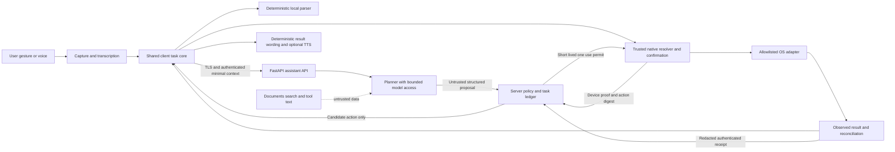

# Proposed assistant architecture

2026-11-12 implementation update: Phase 1A was authorized and its source security foundations are implemented. See [implemented scope and remaining native/release gates](phase-1a-security.md). The broader action architecture below remains the design for subsequent phases.

Status: proposed for approval, 2026-11-07. [Verified foundation](review-coverage.md), [feasibility](feasibility.md), [authorization policies](permissions.md), [threat model](security-threat-model.md). This document specifies future work; no new runtime code or schema was installed.

## Structure and trust boundaries

Use the existing modular FastAPI service as the cloud planning/control plane. Use a small shared TypeScript package for client task state, validation contracts, deterministic parsing and platform-neutral orchestration. Keep device execution and the final security check in compiled Kotlin/Swift adapters. A web adapter has only browser privileges. The shared package is not a plugin loader and does not own secret keys.

Boundaries: microphone/ambient audio -> application; JS/model proposal -> trusted policy; device -> backend; backend -> external provider; application -> OS/third-party composer; each user/account/device -> its own task partition. Server policy can reject a proposal but cannot replace native user confirmation. OS permission grants authorize API access, not a transaction. Even a compromised model has no direct tool transport, shell, filesystem path, arbitrary URL, credential, or device key.

## Reuse and integration map

| Existing component | Reuse | Required separation/change after approval |
| --- | --- | --- |
| `backend/app/core/security.py` | Principal resolution, guest distinction, ownership conventions, token revocation | Add device-bound scopes and fresh-auth proof; never accept caller user_id as authority |
| `google_auth.py`, `user_service.py`, `rate_limits.py` | Verified identity and account budgets | Keep regression coverage; add action-specific budgets and enrollment limits |
| `schemas/*`, `scripts/generate_api_contracts.py` | Pydantic-first wire contracts and generated client types | Extend generator for assistant types; reject unknown fields and versions |
| `llm_service.py` / Google GenAI SDK | Provider client conventions and bounded I/O | Separate nonstreaming structured planner; never route action commands through general chat persistence, RAG routing or prompt logging |
| SQL connection and lifecycle modules | Explicit transactions, unique IDs, deletion leases as patterns | Dedicated task tables; execution retry semantics differ from cleanup retries |
| Web/native API transports and conversation stores | Cancellation, identity-change handling, draft isolation | Separate assistant task state and confirmation UI; protect secrets and bind responses to task revision |
| Chat input, modals, theme, accessibility patterns | Existing design language and transcript entry | Typed action card with unambiguous state; generic confirmation modal alone is insufficient for sensitive native execution |
| Expo/EAS and Docker | Existing delivery and deployment shape | Native development builds, runtime compatibility, signature/provenance review; no extra service for MVP |

Candidate placement: `backend/app/assistant/{schemas,planner,policy,service,repository}.py`, an assistant router, `packages/assistant-core`, platform UI directories, and a local Expo module under `mobile/modules/assistant-device`. These are proposed paths. The pure TS package can use explicit local `file:` dependencies in the two existing packages; do not convert the repository to npm workspaces merely for this feature. Verify Metro/Vite packaging and pin generated contracts. Policy-critical rules remain independently enforced in Python and native code, with common conformance fixtures; sharing client code does not eliminate independent authorization.

## Interfaces and capability registration

Each compiled, reviewed capability declares `capability_id`, major `schema_version`, platform/OS constraints, risk, exact input/output JSON schemas, permission prerequisites, consent scope, confirmation policy, resolver, executor, verifier, timeout, retry class, audit projection, cancellation and revocation hooks. Reject unknown capabilities/properties, NaN, oversized strings/arrays, nested tool calls and unsupported versions. The LLM receives only a filtered description of currently eligible capabilities; capability discovery is a hint, rechecked at execution.

Separate interfaces: `SpeechInput`, `WakeDetector`, `IntentPlanner`, `CapabilityCatalog`, `PermissionBroker`, `AuthorizationPolicy`, `ConfirmationPresenter`, `DeviceExecutor`, `ResultVerifier`, `TaskStore`, `SpeechOutput`. Inject clocks, provider clients, stores and OS facades. Do not introduce an agent framework or service per interface. No dynamic imports, downloaded scripts, arbitrary Android Intent extras, unrestricted URL opener, JavaScript evaluator, shell tool, accessibility automation or remote plugin marketplace.

Model output is `ActionProposal[]` with bounded dependencies and argument placeholders. The server assigns task/action IDs and risk; the model cannot lower risk, choose account/device authority or claim confirmation. Recommended limits: 5 steps, 1 model call plus at most 1 schema-repair attempt, 8 KiB proposal, 30-second planning deadline. Deterministic commands use the same validation and execution path. Low-confidence time/recipient interpretation returns a clarification, not a guessed action.

## Device binding and transaction authorization

1. Registered users explicitly enable the assistant; guests cannot enroll devices or execute assistant capabilities. After fresh login/step-up, native code creates a nonexportable device signing key where supported. Store public key, account binding, revocation version and capability policy on the server. Verify proof of possession over a server nonce bound to account, installation, origin and enrollment expiry. An attestation signal can strengthen risk assessment; it does not prove user intent.
2. Mobile bearer credential storage moves to platform-backed secure storage. The native executor owns the signing key and confirmation handle. JS cannot set `confirmed=true` or invoke an unguarded privileged method. A reinstall/restore or changed backend requires enrollment again; never transfer authorization through a copied AsyncStorage profile.
3. Planner proposes `sms.compose` with recipient alias and message. Native resolver selects the actual contact endpoint locally, rejects ambiguity and freezes an immutable argument snapshot. Normalize numbers; render exact destination and message safely, including suspicious Unicode/control-character indications. Any edited content creates a new revision.
4. Native policy checks current account, local consent, OS permission, unlock state, foreground state, installed handler and capability allowlist. Its own confirmation screen renders that snapshot. Sensitive operations need deliberate confirmation; fresh device authentication is required for enrollment, new external integrations and the high-risk cases in [permissions](permissions.md).
5. Create a digest over deterministic encoding of capability/version, all resolved arguments, task/action/revision, account, device, backend origin, consent/policy versions, nonce and expiry. Use a standard canonical encoding with cross-language vectors, not ad hoc concatenation. Submit a device-signed authorization request; the backend atomically checks scope, session, device state, digest and nonce and issues an opaque single-use permit with a proposed 60-second expiry. It stores only the digest for local private arguments where possible; it cannot validate hidden message semantics, so native policy remains mandatory.
6. Immediately before execution, native code obtains the permit via an authenticated device-bound TLS exchange, rechecks local conditions, and claims the action in its durable ledger. The server atomically consumes the permit. Duplicate consumers lose. Native code checks that the consumed permit matches the exact locally displayed action, then invokes only the registered OS operation. Narrow step-up proof is tied to this action digest, not a reusable `biometric_passed` flag.
7. Record the strongest observable result. A device-signed receipt binds action, attempt, status and limited evidence. Server receipts are reports from the device, not proof against a fully compromised OS. Native crash recovery reconciles owned OS objects; sensitive operations with uncertain outcome are never automatically replayed.

Opaque online permits avoid adding a custom signing infrastructure for offline cloud authorization. Their cost is an extra round trip. Replay protection is provided by both an atomic server consume and native durable claimed state; there is still an unavoidable crash window around external side effects. Mark it `outcome_unknown`, never assert universal exactly-once execution.

Web uses a server-managed HttpOnly, Secure, narrowly scoped cookie session for the new assistant boundary, explicit origin/CSRF checks, and passkey/re-authentication where needed. Existing bearer API compatibility can remain during a versioned migration; assistant endpoints must reject legacy unbound credentials. HttpOnly prevents token reads but does not make XSS harmless. A browser installation is not a hardware-trusted phone identity; no browser-to-phone execution is enabled in MVP.

## Task protocol, persistence and failure semantics

Additive API namespace proposal: `/api/v1/assistant` with an explicit `protocol_version`. Operations: device enrollment/revocation, capability discovery, task proposal/revision, transaction authorization/consume, result receipt, task read/cancel and history deletion. Use POST for mutations. Repeated requests carry an `idempotency_key` scoped by principal/device/capability and a payload digest; same key/different digest is 409. Enforce ownership on every lookup and validate a device signature on privileged operations. Keep existing chat modes and SSE events unchanged. If progress uses SSE, events report persisted state only and cannot trigger execution.

Proposed states: `draft -> resolving -> needs_clarification | needs_permission | awaiting_confirmation -> authorized -> claimed -> executing -> verified | handed_off | failed | outcome_unknown`. `cancelled` and `expired` apply before side effects; after dispatch cancellation is best effort and the UI says so. Append monotonically increasing state revision and reject stale compare-and-swap writes. `handed_off` is terminal for composer-opening capabilities, not equivalent to a sent message. Distinguish `scheduled`, `submitted`, `delivered` and `user_acknowledged` evidence where APIs expose them.

Tables: `assistant_devices`, `assistant_consents`, `assistant_tasks`, `assistant_actions`, `assistant_permits`, `assistant_events`. Foreign keys and unique account/device/action/idempotency constraints; explicit expiry indices; encrypted sensitive columns; no raw audio or entire contact book. Local encrypted ledger maps action IDs to app-owned OS object IDs, keeps replay tombstones and stores pending results. Use authenticated encryption with key versioning, not reversible obfuscation or a hash of predictable text as encryption.

Use SQLite/Turso behind the current boundary. Prove atomic permit claim, concurrent updates, rollback and uncertain commits in both modes before rollout. Do not reuse chat session lifetime for reminder lifetime. New versioned expand/contract migrations require backup/restore fixtures and downgrade compatibility; startup ALTER checks alone are insufficient for this change. App-owned reminders live primarily in the OS scheduler plus encrypted local metadata; no cloud cron dependency for phone delivery. MVP has no server-triggered actions, queue, push command channel or cross-device sync.

For multi-step commands, resolve dependencies and present ordered steps. Each sensitive step receives its own transaction confirmation. Execute sequentially in MVP; stop dependent steps after failure, preserve earlier successful results, and offer explicitly confirmed compensating actions only where supported. Never undo a sent message or retry a call to make a plan appear atomic. A changed contact, timezone, message, permission, lock state or plan revision invalidates the earlier confirmation.

On disconnection, existing scheduled OS reminders continue subject to OS behavior. Allow only foreground local display/audio adjustments under current local consent; no cloud authorization is inferred. No new sensitive action is queued for automatic execution after reconnect. Local actions cannot honor a remote revoke until connectivity returns; they must not access account/private external data. Expired account state requires sign-in for assistant data access. Revocation stops new actions and prompts whether to cancel already scheduled reminders; it cannot retract completed external effects.

## Data flows and performance

Default voice flow is microphone -> local recognizer -> local transcript -> deterministic parser. Optional cloud planning sends the minimum user-approved transcript, locale/timezone, selected capability descriptors and bounded task context to FastAPI and a reviewed paid AI provider. Resolve contact destinations locally; send aliases/placeholders when possible. Never append the address book or a full calendar to a planning prompt. Untrusted calendar titles, files, search results and tool text have data provenance and cannot initiate actions. See [privacy data inventory](privacy.md).

Render completion language from the verifier's typed state. The model may paraphrase only within that state and cannot invent success. TTS is disabled for sensitive content while locked and can be stopped immediately. Do not feed TTS back into the microphone planner. Use bounded audio buffers, one capture/planning task per device, per-account quotas, cancellation propagation and no polling while idle. Keep current GenAI SDK, but select the planning model by schema-validity, intent accuracy, privacy terms and measured latency, not configured model-name assumptions.

## Architectural decisions and alternatives

| Decision | Alternative and tradeoff | Security and Contexify fit |
| --- | --- | --- |
| ADR-01 Existing modular backend | Microservices/agent platform add network, operational and credential surfaces | Current scale does not justify new infrastructure; enforce module boundaries and bounded workers |
| ADR-02 Expo plus narrow native module | Rewrite both native apps duplicates UI; JS-only cannot implement all OS services safely | Preserve established app; compiled adapters own sensitive confirmation and execution |
| ADR-03 Pydantic contracts + pure TS core | Duplicated handwritten protocols drift; full package/workspace conversion expands scope | Extend existing generator; independent native validation remains necessary |
| ADR-04 Local deterministic commands + optional cloud planning | Always-cloud costs privacy/latency; all-local LLM raises model/battery complexity | Same policy gate regardless of planner; benchmark before adding bundled model |
| ADR-05 Online device-bound one-use permits | Reusable bearer or offline signed grants have broader replay/revocation windows | Extra RTT accepted for sensitive safety; offline scope sharply limited |
| ADR-06 Native ledger + existing SQL | Redis/queue needed only for later distributed jobs | Durable state is mandatory; process dictionaries cannot authorize execution |
| ADR-07 Composer-first communication | Direct SMS/call APIs increase policy and irreversible-side-effect risk | Official user confirmation boundary; honestly report handoff only |
| ADR-08 Separate assistant data path | Existing chat auto-persists prompt/title and can invoke search/RAG | Prevent inadvertent private command storage and third-party disclosure |
| ADR-09 Platform crypto and reviewed libraries | Custom crypto or browser-stored secret key gives false assurance | Keystore/Keychain, server key management and strict origin binding; compromised endpoints remain a residual risk |

Every additional capability requires schema/policy review, provider/data-flow review, negative tests, device evidence, rollout flag and an explicit verifier. No capability can widen its own privileges at runtime.
