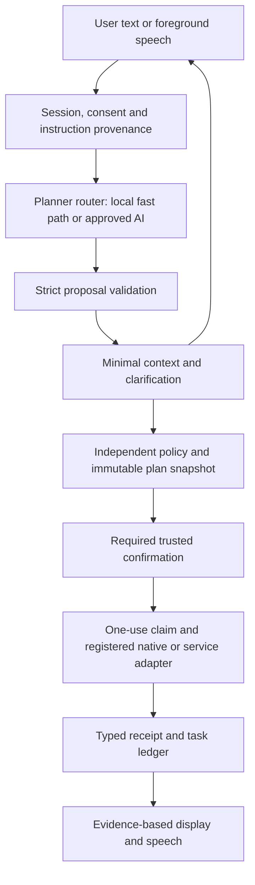

# Merged assistant implementation plan

**2026-11-20 M7 command-flow checkpoint:** the user chose to continue the current architecture and defer ready-made library selection. [M7](m7-communications.md) now connects typed/final on-device voice public test commands to non-executing AI proposals, local single-recipient selection, private missing-message completion and exact native dial/SMS approval. The user explicitly keeps real names/numbers/messages local; mobile and server enforce the reviewed public corpus before provider processing. Existing settings consent/budgets/cancellation are reused, with no private scope, new per-command flag, new dependency or automatic call/send. Automated/source checks and a built/inspected code-7 Android test APK are available; physical/live-model acceptance remains Pending in the single combined M7 batch. M6 Apple verification stays deferred. D6 direct operations, D13 connectors/library choice and release gates remain conditional.

**2026-11-19 M7 source checkpoint:** [Private contacts and phone composers](m7-communications.md) add a native single-phone-property picker, exact private number/message review and OS dial/SMS composition on Android and iPhone source. The first selected messaging adapter is system SMS; no broad contact access, private Gemini request, generic signer or automatic send/call is added. This is user-owned OS presentation, not a planner execution adapter. Compatible Android artifact/device acceptance and Apple compilation/signing/device checks remain open. Optional external services/connectors and direct sensitive communications keep their D13/D6 gates; this does not mark all M7 or production ready.

**2026-11-19 M5 alarm-handoff checkpoint:** [Reviewed Clock requests](m5-alarm-handoffs.md) now have a private form, independently scoped online authorization and exact native approval, reviewed handler/change checks and truthful terminal handoff outcomes. Labels/times stay outside chat, Gemini and account reminder storage. Existing app handoffs reuse the shared native executor. The compatible code-6 test APK is built and inspected; the isolated backend has since been restarted and trusted HTTPS/alarm scopes verified. The agreed basic Samsung Clock batch is user-reported passed: creation/ringing, Cancel/Home before approval and view-only opening. Advanced physical/release acceptance remains pending. The owned-ringing feasibility requirements are documented; owned alarms, physical/release acceptance and earlier deferred checks remain open. Source/build completion does not establish installation or Clock behaviour on the phone.

Reviewed: 2026-11-16. Scope of this revision: analysis and documentation only.

**2026-11-18 M5 basic phone checkpoint:** the compatible code-4 test APK is delivered. The user confirmed all three agreed Spotify checks passed: approved volume-then-app execution, saved results without replay, and cancelled app opening after the volume approval. This closes that basic batch; [M5 evidence](m5-application-handoffs.md) and [Android acceptance](android-acceptance.md) distinguish it from pending Clock/fault/release checks. Reminders/scheduling/alarms and existing deferred work remain open.

**2026-11-18 M5 first-slice checkpoint:** [M5 app-opening evidence](m5-application-handoffs.md) records reviewed Android Spotify/Clock launcher handoffs, terminal-plan policy, old-binary capability discovery, exact native confirmation and encrypted handoff evidence. This source slice does not complete M5: owned reminders/scheduling, alarm work, compatible delivery and physical acceptance remain pending. Existing deferred tests and D8/D12 release decisions remain open. No new APK, live provider call, backend restart or production enablement is inferred.

**2026-11-18 M4 source checkpoint:** [M4 evidence](m4-operation-recovery.md) records the bounded native settings coordinator, stable plan/revision/step identity, encrypted minimal checkpoints, per-step confirmation, conservative partial/unknown results and user-initiated read-only reconciliation. Existing v1 session isolation is preserved; unsupported whole plans remain previews. Source implementation does not close pending M2/M3 or M4 physical/release acceptance. A compatible new native binary is required; no build, provider request or production enablement is inferred.

**2026-11-17 post-M3 live/delivery checkpoint:** the user resumed live public-command connection, local APK and manual S25 verification before M4. After original-model 503/504 errors, the explicit Flash-Lite/MEDIUM pin passed the three critical interpretation cases across an interrupted run plus a delayed check. The isolated backend now uses that pin and the user-approved 30/day public-test cap; certificate-verified HTTPS auth/consent/live-negation checks passed. The compatible APK is installed; native popup, lock cancellation and microphone Close/reopen are user-confirmed. The public single-volume AI-to-phone path is now user-confirmed: Send command opened native approval, approval changed volume, and the inline result reported the update. M3 relative-state and remaining release acceptance are pending. See [current evidence and delivery](live-public-evaluation.md). Production/default live-binding and private-cloud-processing gates remain unchanged.

**2026-11-16 implementation start:** the user subsequently authorized implementing this roadmap one stage at a time and selected free-tier Gemini with no paid spend. [M0 baseline and decisions](m0-baseline.md) records the source/contract freeze, initial development model, synthetic-only cloud-test scope, INR 0 paid budget and first single-volume-action target. This supersedes the earlier planning-only boundary for authorized local development. Live-provider activation, private cloud processing, paid services, builds, postponed phone tests and production release retain their separate gates.

**2026-11-17 M1 development checkpoint:** the [non-live planning foundation](m1-planning.md) is implemented with scoped consent grants, strict proposal contracts, an isolated endpoint, bounded/cancellable generation and an explicit synthetic-only Gemini adapter. The default runtime has no provider attached; no live request or private-data processing was performed. Automated evidence: 605 backend tests, 111 JavaScript cases, both client type checks and generated-contract checks passed. M2's UI and validated-snapshot wiring is next; live compatibility/model quality, deferred phone checks and release acceptance remain open.

**2026-11-17 M2 source-integration checkpoint:** [M2 evidence](m2-dynamic-volume.md) records the authenticated command-screen path, immutable validated review, no execution-side transcript reparsing, single-volume transition directly to exact native confirmation, browser preview and lifecycle cancellation. Source/mock integration is complete; live-model, compatible-device and deployed acceptance remain pending. Provider attachment/private processing remain gated.

**2026-11-17 M3 settings-context checkpoint:** [M3 evidence](m3-context-clarification.md) records explicit local clarification, unit-safe relative-volume math, short-lived previous-target choices, one consented local read and native base-state preconditions. The current settings source/tests are complete; broader capability-specific context and all live/binary/physical gates remain open. Raw context/relative-answer fields are not new cloud inputs; final targets/evidence retain the existing execution backend.

This is the canonical roadmap for combining the original secure device-assistant plan with dynamic AI planning and supported integrations. It supersedes the _future ordering_ in [implementation-plan.md](implementation-plan.md), while preserving that document's authorization history and the detailed phase evidence. It does not authorize implementation, provider processing, production changes, new builds or postponed phone tests.

The immediate target is **natural language -> validated plan -> existing secure executor**, first for one supported action. Adding more fixed phrases or more device controls before connecting that path will not solve the current product gap. An assistant can understand many requests; it can perform only capabilities supported by its installed adapters, permissions and policy. Unsupported requests must receive an honest explanation or a safe handoff.

## How to read this plan

- **Old**: retained from the original requirements or roadmap.
- **New**: introduced by the dynamic-planning/integration direction.
- **Updated**: an old requirement whose implementation or ordering changes.
- **Done** means the specifically named artifact or source work exists; it never implies device acceptance or production approval.
- **Pending** means work or evidence is still required. **Deferred** means deliberately postponed, with the dependency still open. **Conditional** means a separate decision, platform entitlement or provider approval is required.

Every stage has an owner, dependencies and an exit gate. Owners are roles: product owner (USER), backend (BE), mobile/native (MOBILE), web (WEB), security (SEC), testing (QA), operations (OPS), privacy/legal (PRIVACY). One person may fill several roles; an owner must be assigned before a stage starts. Unassigned roles block the corresponding release decision, rather than disappearing from the backlog.

The [traceability register](merged-plan-traceability.md) maps the original request, all 19 existing documents, eight old phases, integration steps, decisions, findings and threats to this roadmap. Existing documents remain the evidence sources for historical checks. Conflicting historical estimates, proposed per-command flags and old ordering do not override the decisions here.

## 1. Current truth and immediate gap

| Item                                                                                                                  | Origin        | Source status                                                                        | Verification/release status                                                                               |
| --------------------------------------------------------------------------------------------------------------------- | ------------- | ------------------------------------------------------------------------------------ | --------------------------------------------------------------------------------------------------------- |
| Device/account/origin binding, native keys, scoped sessions, web assistant cookie/CSRF boundary and revocation        | Old           | Phase 1A source exists                                                               | Physical, deployed-topology, restore and operational checks remain open where documented                  |
| Shared schemas, deterministic simulation, policy/task/permit primitives and provider-planner interface                | Old / Updated | Source exists                                                                        | Provider interface is not a live AI integration; simulation is not execution authority                    |
| Foreground Android on-device English push-to-talk and speech output; restricted web adapter; iOS text fallback        | Old           | Source exists; S25 speech user-confirmed                                             | Broader device/lifecycle/privacy checks remain pending or deferred                                        |
| Read-only Android readiness and reviewed application catalog                                                          | Old           | Source exists                                                                        | Readiness is neither permission nor execution                                                             |
| Android media volume, 0-70%, with exact native confirmation and one-use execution                                     | Old           | Source and local build exist; basic effect, Cancel and Home dismissal user-confirmed | Remaining acceptance is deferred; updated limit-feedback APK acceptance is not established                |
| Android Contexify Activity-window brightness, 10-100%, with scoped confirmation and restoration                       | Old           | Phase 4C source and native-module compilation exist                                  | No new brightness APK or physical acceptance; no configured-database v4 migration performed in that batch |
| Dynamic AI understanding in the real review/execution flow | New | M2 client/endpoint/snapshot wiring implemented; legacy local grammar retained as an explicit local mode | Live provider and model/device acceptance remain pending; [M2 evidence](m2-dynamic-volume.md) |
| Reviewed app opening, owned reminders, alarms, communications, calendar, wake, iOS extensions and optional connectors | Old / New     | Pending or conditional                                                               | None becomes implemented merely because an AI model recognizes its name                                   |

The installed online volume-test app does not gain native brightness support from a JavaScript change. Production, the offline Assistant Test app and the online Volume Test app have different identities and purposes. Preserve their separation and use [local testing](local-android-testing.md) for the current configuration; do not point a test build at production data.

Remaining phone checks are **Deferred at the user's request**. [Android acceptance](android-acceptance.md) is the checklist of record. Do not ask again, access the phone, use USB/ADB or build solely to repeat them until the user resumes that work. Deferred checks allow independent local development; they do not close any dependent release gate. No EAS/cloud build or retry is authorized by this plan.

## 2. Architecture decision

**Updated: use a bounded planner, an independent policy boundary and trusted adapters inside the existing application.** Keep the FastAPI backend, separate React/Vite and Expo packages, shared assistant core and native modules. Reuse the installed, pinned Google GenAI SDK where appropriate; select and approve the actual processor/model/tier before live processing. Do not add an agent framework, microservice, Redis, vector database or npm-workspace migration without a demonstrated requirement.

The model proposes typed arguments; it cannot grant permissions, select a privileged backend, mark itself confirmed, mint a permit, dispatch arbitrary code or declare success. Provider function calling describes an application-mediated execution pattern, not independent device authority. Structured output constrains format; application validation and authorization are still required. [Google function calling](https://ai.google.dev/gemini-api/docs/function-calling), [Google structured output](https://ai.google.dev/gemini-api/docs/structured-output).

Integrating an AI model/API does not assume access to another assistant application's OS privileges. Any proposed delegation to Gemini, Google Assistant or another application must first have a verified public API and its own permission/evidence contract. The initial integration uses Contexify's reviewed adapters; it does not depend on borrowing another application's device-control authority.

Keep speech recognition, wake detection, TTS, planning, capability discovery, policy, execution, verification and task state as separate interfaces. This permits a new language or model without weakening the native execution boundary. Existing Android handlers remain necessary: dynamic language replaces phrase matching, not the platform code that actually performs an approved action.

### 2.1 New planner contract and one shared action pipeline

**New:** introduce a versioned, non-authoritative planning contract, conceptually `PlanProposal`, using existing action schemas where compatible. The existing simulation proposal's `mode: "simulation"` must remain a simulation contract. Do not reinterpret it as permission to execute.

The model may propose only registered capability IDs, schema-bound arguments, bounded dependencies and clarification information. Trusted application code assigns plan IDs, revision, step IDs, user/device binding, policy/schema versions, expiry and status. It resolves real targets and computes the canonical action digest. Model-provided risk, scope, authentication level, availability, confirmation or execution status is rejected or ignored by contract.

Define explicit non-executing outcomes for clarification, unsupported/refused requests and read-only answers, alongside action plans. A question must not become an imperative just to fit an action schema. Private schedule/history answers require authorized reads and evidence; general conversation must not silently move a private assistant request into the existing persistent chat path. No answer or model confidence score is authority to perform a device action.

Review, confirmation and execution consume the **same validated action snapshot**. Replace the current transcript reparsing in the volume/brightness client helpers. Editing text, changing targets, replanning or changing policy invalidates the previous snapshot and its approvals. Preserve v1 simulation and percentage-execution APIs for existing clients; add versioned contracts rather than silently widening them. Generate shared wire types and test Python/TypeScript/native canonicalization together.

The local grammar may remain as a cheap, optional fast path into this same validation/policy pipeline. It must not be required after successful AI planning. A local policy rejection, such as volume 90%, must not trigger an AI attempt to bypass the limit. Do not silently clamp or reinterpret the user's requested amount.

### 2.2 Dedicated private planning endpoint

**New:** add a dedicated authenticated assistant planning endpoint and provider adapter. Keep it outside chat modes, chat history, title generation, RAG, attachments, embeddings, search, general chat streaming and raw request logging. Use the assistant session boundary: enrolled native device sessions, or the restricted web cookie/CSRF/origin flow. A planning response has no effect authority. Guests retain an explicit local preview; no hidden cloud processing or execution.

Introduce an explicit planning-only scope/consent contract rather than widening existing simulation or effect scopes. Scope issuance, device/session rotation, expiry, revocation and web/native differences need endpoint tests. A plan is visible only to its owner and is not a transferable authorization token.

The existing backend LLM service has chat context, model fallback and a different timeout. Reuse safe SDK/connection-lifetime patterns, not that complete data path. Disable SDK automatic function execution and do not expose privileged callbacks to the model. Verify the exact option against the pinned SDK before implementation; current documentation examples do not establish compatibility with the installed version. Buffer and validate complete outputs before presenting executable steps; streamed partial JSON never executes.

Cloud text planning requires a separately approved processor/tier/region/retention policy and explicit user opt-in. Existing API credentials or chat consent are insufficient. No silent provider, region, model-tier or cloud-speech fallback. With consent declined, budget exhausted or provider unavailable, offer local supported commands, clarification or an honest unavailable state. Existing online volume/brightness execution still needs its HTTPS backend; local understanding does not make execution offline.

### 2.3 Capability registry and context

**Updated:** each registered capability declares version, platforms/minimum runtime, typed inputs/outputs, units/ranges, permission/scopes, risk/confirmation, state reads, cancellation/revocation, idempotency, timeout/recovery, evidence semantics and tests. Client availability reports are hints, not authority. Intersect the released capability catalog with compiled native handlers, current policy and grants; recheck immediately before dispatch.

Expose to the planner only the minimum applicable catalog. Unsupported or unavailable actions stay visible to the user as such, rather than being invented by the model. The UI must distinguish **understood**, **implemented**, **available**, **authorized**, **handoff** and **verified**.

**New:** relative requests need trusted state reads. For “make it quieter,” clarify the amount unless the user has explicitly configured a bounded default. Distinguish percentage points from percentage changes. Bind the resolved absolute value and any relevant base-state precondition to the snapshot; if the base changes before execution, re-evaluate and obtain any required fresh confirmation. Do not silently recompute an already approved action.

Use local contact pickers and narrow calendar/state queries with consent. Give the model opaque selected references or minimal redacted fields instead of entire contact databases or histories. Resolve collisions, time zones, daylight-saving changes, units and follow-up references before approval. Conversation context is session-scoped, minimal and cleared on the documented lifecycle/account boundaries; it is not unrestricted chat memory.

### 2.4 Coordination, replay and recovery

**New:** start with one action, then add a bounded dependency graph of at most five steps. Reject cycles, duplicate IDs, forward/invalid dependencies and unsupported steps. Resolve the whole plan's support before any effect; never silently execute only the supported first half. Serialize device writes initially. Per-step policy, approval and receipts apply; one confirmation is not permission for an entire changing plan.

The current native percentage executor creates a fresh task/idempotency UUID for each call. That is insufficient for a resumable AI plan: a timeout followed by another call could become a new operation. Before multi-step resume/retry, add a trusted coordinator and a versioned bridge binding stable `(plan_id, revision, step_id)` identifiers to account, device, capability and canonical arguments. Preserve the existing v1 session-bound lookup/isolation rules. A deliberately new command gets a new operation identity; an accidental retry of the same step does not.

Persist the minimum encrypted recovery metadata before an effect may occur. Use atomic one-use claims and compare-and-swap plan revisions. A lost response, crash, reboot or ambiguous receipt produces `outcome_unknown` when success cannot be established. Reconciliation is read-only until a genuinely new, explicitly authorized operation is requested. Never replay a completed/claimed/unknown step automatically after reconnect or sign-in. Do not promise exactly-once effects across arbitrary OS or third-party failures.

On failed/unknown steps, stop dependent steps and explain completed, pending and uncertain parts. Independent continuation requires a defined policy and user choice. Do not invent rollback: cancelling a plan does not undo a completed call or message. A reviewed app handoff may intentionally background Contexify; record that expected handoff without allowing background continuation or treating it as proof of delivery.

### 2.5 Confirmation and user experience

**Updated:** design a useful assistant interaction: final text/speech -> automatic planning or clarification -> concise action summary -> the required trusted approval -> result. Remove redundant manual Review/Confirm layers only after wiring the common snapshot; do not remove the native security boundary as a UI shortcut. Existing exact native confirmation remains mandatory for current volume/brightness executors until a separately reviewed policy change is implemented and verified.

**Conditional, D11:** evaluate standing, revocable consent for narrowly bounded low-risk actions later. That requires a clear scope, foreground/unlocked requirements, bounds, expiry, visible activity, quick disable and new native policy tests. OS permission alone is not consent to every future command. Sensitive actions keep transaction-specific confirmation of recipient/destination/content and justified device-authentication step-up. Ambient “yes,” wake recognition and a model's confidence are not identity proof.

Do not enable standing consent before stable operation identity and duplicate-command protections are in place, including for a single low-risk action. Deferred native lifecycle/privacy acceptance and the new policy's device checks must close before that behavior is offered to users.

Show errors beside the initiating control, with accessible focus/announcement and clear recovery. The 90% limit case must produce visible rejection, not silence. Distinguish a request being planned from a device change in progress; preserve Stop/Cancel. Say “opened draft,” “handoff requested,” “scheduled,” “verified media-volume readback” or “outcome unknown” as warranted. Window-attribute readback does not prove physical screen luminance; Android volume quantization may differ from an exact percentage. AI-generated prose cannot override ledger evidence.

### 2.6 Optional integrations and alternatives

| Choice                                                   | Decision and trade-off                                                                                                               |
| -------------------------------------------------------- | ------------------------------------------------------------------------------------------------------------------------------------ |
| Existing SDK with a small planner adapter                | Recommended first. Fewer dependencies, explicit budgets and reviewable data flows; Contexify still owns validation and orchestration |
| Large agent framework or unrestricted computer-use agent | Not justified for the MVP; increases dependency/permission surface and does not solve platform authority                             |
| Own trained model or local model on every phone          | Not required initially. Reconsider only after measured privacy, memory, quality, licensing and device-coverage trade-offs            |
| MCP or other tool protocol                               | Optional later connector interface, not a device permission mechanism or a requirement for dynamic planning                          |
| Fixed grammar only                                       | Retain as an optional fast path/fallback; insufficient as the main natural-language assistant                                        |

**New, conditional:** any connector needs a reviewed publisher, pinned tool definitions, restricted OAuth scopes, explicit per-account opt-in, audience-bound credentials, revocation/rotation, egress restrictions and receipt semantics. Never pass service tokens through the model or accept arbitrary tool servers/URLs. Prevent SSRF, redirect/DNS rebinding, token passthrough and confused-deputy behavior. The MCP security guidance is useful input; freeze and review the actual protocol/version before adoption, rather than shipping against a moving draft. [MCP security guidance](https://modelcontextprotocol.io/specification/draft/basic/security_best_practices).

Tool descriptions/results and documents are untrusted data, not new user instructions. Minimize tool surface and permissions; retrieval or a system prompt alone is not a prompt-injection defense. [OWASP prompt injection](https://genai.owasp.org/llmrisk/llm01-prompt-injection/), [OWASP excessive agency](https://genai.owasp.org/llmrisk/llm062025-excessive-agency/).

## 3. Full product scope and platform boundaries

All entries are **Old** unless marked New/Updated. This is a scope map, not a claim of current support. [Feasibility](feasibility.md) and [permissions](permissions.md) retain the detailed platform and authorization matrices. Revalidate official platform documentation, supported OS versions and entitlements when each adapter is selected.

| Capability family                 | Planned behavior                                                                                                 | Boundaries and release conditions                                                                                                                                    |
| --------------------------------- | ---------------------------------------------------------------------------------------------------------------- | -------------------------------------------------------------------------------------------------------------------------------------------------------------------- |
| Input/output and conversation     | PTT, text, TTS, paraphrases, clarification, relative requests, follow-ups and bounded multi-step plans (Updated) | Separate capture/planner/output consent; stop on lifecycle changes; no quoted/document text treated as a command                                                     |
| Volume and brightness             | Existing Android media volume and Contexify window brightness                                                    | Existing ranges and native approval; web/iOS own media/UI only where supported. System brightness is a separate special-access design, not implied by window control |
| Application/settings handoffs     | Reviewed Spotify/Clock apps and public settings destinations                                                     | Catalog IDs and native templates only; missing handler explained. No arbitrary intents, schemes, packages or extras                                                  |
| Owned reminders                   | Create/list/cancel Contexify-owned reminders with encrypted metadata                                             | Date/time/time zone/DST/recurrence/past-time ambiguity, permissions, reboot/reconcile, deletion/logout and notification privacy; never cancel another app's objects  |
| Alarms and timers                 | Public alarm request/handoff first; owned scheduling/cancellation where officially supported                     | Exact-alarm access, OEM/Doze/force-stop behavior and precise-vs-inexact disclosure. Cancel-next-alarm requires identifiable owned state or an honest handoff         |
| Contacts and calls                | System picker/minimal contact resolution; reviewed dialer/call composer first                                    | Duplicate names clarified; exact number and intent; handoff is not a completed call. Direct calling needs separate sensitive-action approval                         |
| SMS and messaging                 | Exact recipient/content review and supported composer/draft handoff                                              | WhatsApp draft/click-to-chat is not “sent.” Direct SMS or business-provider send is separately gated; no consumer-app scraping or accessibility automation           |
| Calendar and system reminders     | Today's schedule, create events, read supported reminders with narrow grants                                     | Provider/EventKit/editor permissions and availability; no general Android access assumed to arbitrary reminder apps; redact lock-screen/private output               |
| Private activity history          | User-visible sensitive-action evidence, export/delete and recovery                                               | Separate from chat and analytics; encryption/key/retention design must precede durable private content                                                               |
| Approved service connectors (New) | Useful external tools through typed adapters                                                                     | D13 trust review, narrow credentials, per-integration consent and no expansion of native privileges                                                                  |
| Wake and hands-free               | Later local “Hey Contexify” experiment, interruption and voice UX                                                | Android role/background/service/battery/license feasibility; iOS Siri/Shortcuts/App Intents instead of a promise of always-on custom wake; no continuous cloud audio |
| Desktop/cross-device              | Future separately approved architecture                                                                          | Same-device execution is the current boundary. No remote phone executor or unrestricted plugin installation                                                          |

Web/PWA is a restricted planning/foreground input surface, not native phone control. A closed tab or service worker is not a continuous microphone or a reliable exact-alarm service. Browser recognition must satisfy the approved local-processing contract, or use text; no automatic remote ASR fallback. iOS uses supported App Intents/Shortcuts/Siri and platform APIs, with feature/version/entitlement checks; App Intents/AlarmKit support must be evaluated before promises. Missing capability always has an explicit unavailable state or permitted handoff.

Original local/offline low-risk execution remains a **Pending, conditional** objective, not a current feature. D12 must define bounded offline authority, expiry, revocation limitations, device compromise assumptions and later reconciliation before enabling it. Current signed online execution remains intact. Do not queue new writes to fire automatically when the network returns.

## 4. Privacy, security and configuration invariants

1. **Old:** fresh-auth enrollment; account/device/install/origin binding; scoped short-lived sessions; ownership on every plan, step, permit and receipt. HTTPS and approved origins; fail closed on account/backend change, restore or stale credentials. Web HttpOnly cookies still require CSRF/origin and XSS defenses.
2. **Old:** platform key storage/nonexportable signing keys, sensitive-record encryption with approved key lifecycle, backup exclusions, narrow app components, public OS APIs only. No model shell/code runner, arbitrary URL fetcher, accessibility controller or notification/overlay approval bypass.
3. **Updated:** granular, revocable capture/cloud-text/cloud-ASR/TTS/connector consent. Raw capture remains bounded and ephemeral; retain the existing proposed maximum 30-second capture and 15-minute idle transcript cleanup as requirements to verify, not a claim every path already enforces them. Clear sensitive transient state on explicit termination/account boundaries. No raw audio retention by default.
4. **Old:** private commands never enter ordinary chat history, titles, embeddings, search, advertising, analytics or unredacted crash reports. Use allowlisted operational metadata and opaque IDs. Redaction is not permission to log raw bodies first. Review SDK debug/trace and HTTP error logging too.
5. **Updated:** approve external data fields, processor/tier/region/subprocessors, retention/training terms, deletion and fallback in D4/D8 before a live planning request. A “free” or existing provider account is not automatically approved for private commands. Legal requirements for India/other selected regions require a current qualified review; older dates or prices are not legal/commercial assurances.
6. **Old:** private action history, export/delete, revocation, schedules, incident response and backup restore require explicit lifecycle rules. Reapply deletion/revocation tombstones before serving restored records. App logout cannot retract another app's drafts/sent messages; disclose those limits. Do not store contacts, tokens, messages or keys in plaintext.
7. **Updated:** keep one shared real-execution gate (`ASSISTANT_EXECUTION_ENABLED` on the server and corresponding compiled client opt-in), separate security and simulation gates, and per-capability **policy/registry data**. Do not add a volume/brightness/call environment variable for every command. Distinct purposes such as optional cloud speech or wake may need separate rollout controls. All production execution defaults remain off until approved gates close.
8. **Old:** provider secrets stay server-side; public bundle settings are not secrets or authority. Do not widen test CA trust, production app identity or production networking. The offline test app remains offline; the online test app remains isolated. Reuse existing SQL adapters and additive migrations; preserve v3 volume and v4 brightness compatibility. New migration numbers must be determined from the repository when implementation begins.

Use versioned [OWASP ASVS](https://asvs.owasp.org/) requirements (target Level 2 with selected stronger controls for sensitive paths), [MASVS](https://mas.owasp.org/MASVS/) control groups, API Security Top 10 and AI threat tests as verification references. These are engineering targets, not a certification or an assurance of zero vulnerabilities. All TH-01..TH-20 and historical ASST-001..ASST-010 remain in [traceability](merged-plan-traceability.md).

## 5. Delivery stages and completion gates

Security/privacy/operations work is a dependency throughout these stages, not something postponed until the final stage. A stage closes only for its stated artifact and environment. Source checks, fake adapters, native compilation, an installed APK, physical acceptance and production approval are separate evidence levels.

| Stage / origin                                                             | Owner and dependencies                                                                 | Deliverables                                                                                                                                                                                                   | Exit gate and current status                                                                                                                                                                                                                                                                               |
| -------------------------------------------------------------------------- | -------------------------------------------------------------------------------------- | -------------------------------------------------------------------------------------------------------------------------------------------------------------------------------------------------------------- | ---------------------------------------------------------------------------------------------------------------------------------------------------------------------------------------------------------------------------------------------------------------------------------------------------------- |
| **M0: baseline and decisions — Updated**                                   | USER + SEC + BE/MOBILE; this plan reviewed                                             | Freeze current contracts/capability truth, assign owners, select first dynamic examples, decide D4/D8/D9 live-processing prerequisites; record deferred tests and baseline regression scope                    | Development baseline and initial free-tier/synthetic-only/INR 0 choices **Done**, recorded in [M0](m0-baseline.md). Local implementation authorized; live/private processing and dependent acceptance/release gates remain closed                                                                          |
| **M1: private planner foundation — New**                                   | BE + SEC + WEB/MOBILE; M0                                                              | New non-authoritative plan contract/catalog; authenticated isolated endpoint; pinned-SDK adapter with no automatic tool execution; consent, cancellation, budgets, fake-provider tests and evaluation fixtures | Non-live source and isolated checks **Done**, evidence/limits in [M1](m1-planning.md). No runtime provider binding or private input egress; actual provider compatibility, language quality and deployed privacy evidence remain gated                                                                     |
| **M2: first visible dynamic action — Updated; immediate product priority** | MOBILE + BE + WEB + QA; M1                                                             | Route real foreground text/PTT review through planner and validated snapshot; replace regex reparsing; one supported volume or window-brightness action; accessible error/result UX, web planning preview      | Paraphrase such as “put my media sound halfway” reaches the supported adapter with exact native approval; 90%, ambiguity and unsupported actions visibly fail safely. Fake-port automation first; approved live-provider and compatible-binary/device acceptance before claiming real support. **Source/mock integration Done**; [M2](m2-dynamic-volume.md) records evidence. Live-model/device/deployed acceptance **Pending** |
| **M3: context and clarification — New**                                    | BE/MOBILE/WEB + SEC + QA; M2                                                           | Narrow trusted state reads, relative values, units, session references, target/time resolution, consent and clarification                                                                                      | “Quieter,” “a little brighter,” “that one” and conflicting/ambiguous input clarify or resolve against fresh authorized context, with no guessed targets or full contact upload. **Settings source/tests Done**; [M3](m3-context-clarification.md). Broader target/time context remains with the M5/M7 adapters; live/binary/physical acceptance **Pending**                                                                                                                |
| **M4: multi-step orchestration and recovery — New / Updated**              | BE + MOBILE + SEC + QA; M2, and M3 where context needed                                | Bounded dependency graph; stable plan/step operation IDs; versioned native bridge/coordinator; encrypted minimal recovery, cancellation and read-only reconciliation                                           | Stable native settings coordination and encrypted recovery source implemented; [M4 evidence](m4-operation-recovery.md). Duplicate/concurrency/response-loss/account/restart checks have automated coverage; compatible-binary/physical, D8 production and release acceptance remain **Pending**. Handoff adapters follow M5/M7.                                                                                                                           |
| **M5: complete the old Android MVP — Old / Updated**                       | MOBILE + BE + QA + PRIVACY; M2 and relevant M3/M4, encryption decisions before storage | Reviewed app opens, owned reminders and schedule lifecycle; complete existing volume/brightness acceptance when user resumes it; alarm handoff and later owned alarm feasibility                               | Capability-specific schema/policy/native tests, permissions/reboot/time-zone/OEM cases and physical evidence. Foreground offline execution stays blocked on D12. **App-opening source implemented**; [M5 first slice](m5-application-handoffs.md). Compatible APK delivered; basic Spotify phone batch **User-reported PASS**. Owned reminder/schedule source implemented; [M5 reminder slice](m5-reminders.md). Compatible reminder APK delivered; basic reminder and account-storage phone batches **User-reported PASS**. Reviewed Clock alarm handoff source implemented; [alarm slice](m5-alarm-handoffs.md). Compatible code-6 alarm APK built/inspected; basic Samsung Clock phone batch **User-reported PASS**. Owned ringing and advanced physical/release acceptance **Pending**; prior phone checks **Deferred**                                                                     |
| **M6: supported web and iOS extensions — Old / Updated**                   | WEB + MOBILE + QA; M1/M2 web foundation, M5 only for shared features it uses           | Restricted web UX, feature discovery, iOS native integrations/shortcuts/intents/eligible alarm APIs, calendar/reminder permissions, fallback text/handoffs                                                     | Per-platform compatibility/accessibility, entitlements, permissions and device acceptance. No false parity with Android. **Companion source implemented / acceptance Pending**; [M6 scope and consolidated checklist](m6-platform-extensions.md). Web feature discovery, local iOS voice, user-composed Calendar editor and authenticated Siri entry are included. Owned iOS notifications, AlarmKit alarms/timers, countdown widget, encrypted local state and opt-in notification-reminder account copies are also implemented in source. Mac/SDK compilation, signing and browser/iPhone acceptance remain open; no Android parity claim                                                                                                               |
| **M7: communications and approved integrations — Old / New**               | BE/MOBILE + SEC + PRIVACY + QA; M3/M4 and D6/D13                                       | Contact selection, dial/SMS/messaging composers, calendar/external services; optional reviewed tool connector. Direct send/call separately scoped                                                              | Exact target/content/step-up, provider/store/legal approval and independent assessment **before enabling R3**. Composer and send statuses distinguished. **Public-test AI-to-local Phone/SMS composer flow source implemented; live/device acceptance Pending**; [M7 evidence](m7-communications.md). Direct call/send and optional connectors remain conditional under D6/D13                                                                                                                         |
| **M8: wake, operational acceptance and rollout — Old / Updated**           | MOBILE + QA + OPS + SEC + PRIVACY + USER; D7 and relevant feature acceptance           | Local wake feasibility/license/role experiment; battery/false-trigger evidence; deletion/restore/revocation drills; security assessment, support/incident/rollback and staged pilot                            | Old gates A-F and feature-specific gates close with evidence; separately approve each production capability. Wake is optional if infeasible; PTT remains usable. **Pending / Conditional**                                                                                                                 |

Do not batch all capabilities or platform rewrites into M1/M2. Start with visible end-to-end dynamic behavior using the secure work already present. Broader adapter work follows evidence, rather than masking an unconnected planner with more command examples.

Historical 13-21 engineer-week MVP and 26-43 week full-roadmap estimates belong to the earlier scope; they are not refreshed promises. At M0, estimate M1/M2 against assigned staffing, approved provider and measured integration gaps, then revise remaining stages. Estimate cloud cost from command volume × measured input/output token usage × selected current pricing, plus native QA, security review and operations. Freeze a user-approved monthly cap before live processing. This plan spends no build quota or provider budget.

## 6. Bounds, performance and operational design

**Updated:** optimize measured bottlenecks while preserving every authority check. Reuse connection pools, typed contracts and immutable capability metadata; avoid model calls for unambiguous whole-command fast-path matches. Never cache private plans, permissions or permits as reusable authority. Cache catalog metadata only with version/expiry invalidation. Do not share mutable context between accounts.

| Budget / invariant           | Initial requirement                                                                                                                                                             | Verification                                                                                                                |
| ---------------------------- | ------------------------------------------------------------------------------------------------------------------------------------------------------------------------------- | --------------------------------------------------------------------------------------------------------------------------- |
| Input                        | Retain current 1,024-character limit initially; define consistent Unicode and UTF-8 byte bounds across runtimes                                                                 | Oversize/Unicode corpus, request-body caps and generated-contract conformance                                               |
| Planner output and plan size | At most 8 KiB output and five steps; strict unknown-field/schema/dependency validation                                                                                          | Truncation, expansion, cycle and malformed-output fixtures                                                                  |
| M1/M2 provider use           | At most two attempts total, including at most one schema repair; no retry to override a refusal/policy decision                                                                 | Fake SDK counts and error/budget accounting                                                                                 |
| Planning deadline            | One overall 30-second budget including queue, call and repair; link client/lifecycle/server/SDK cancellation                                                                    | Late-response suppression; repair shares the original deadline, not another 30 seconds                                      |
| Client and native timing     | Planner-specific client timeout must allow the bounded server response, e.g. 35 seconds; preserve separate existing native action/approval/claim limits                         | No global chat timeout increase, no inherited 60-second chat-SDK timeout; human confirmation is outside the planning budget |
| Extended context loops | Current M3 settings flow adds zero model calls and one consented local read per answer, with a 3-second read deadline. No recursive loop. Future iterations remain blocked on D14; proposed ceiling four provider calls within the original overall deadline | Context egress/read-count/cancellation tests; any later read/call budget needs explicit review |
| Execution                    | One device write at a time initially; bounded plan expiry and per-step limits; no unsafe effect retries                                                                         | Concurrency/lifecycle/claim-window tests; D14 sets the whole-plan lifetime separately from human approval                   |
| Capacity and spend           | Per-user/device/tenant rate limits, bounded queue/concurrency, token limits, spend reservation plus usage reconciliation and circuit breaker                                    | Saturation, reservation release, crash/missing-usage accounting, intentional 429 and provider billing-lag cases             |
| Telemetry                    | Opaque correlation IDs, phase timings, outcome/error categories, counts and cost; no commands/contacts/audio/credentials                                                        | Log/crash/network inspection with synthetic secrets; restricted access and retention                                        |

Retain old proposed quality targets until measured and consciously revised: at least 95% intent/slot quality on 500 English commands; 500 direct/indirect injection cases plus 100 malicious-receipt cases with zero unauthorized effects; zero cross-account/permission bypasses. Ambiguous requests are evaluated for safe clarification, not forced completion.

Retain the old performance targets as **unverified goals**: p95 local feedback within 500 ms after final text excluding human delay; final ASR within 1.5 seconds and cloud planning within 3 seconds on the defined stable network. Existing online authorization handshakes may require an evidence-based revision of end-to-end timing. Measure capture, planning, policy, approval, effect and verification separately; do not hide security latency or advertise these figures as achieved.

Wake experiments retain the proposed <=1 false activation per eight hours, <5% misses, <=3 percentage-point incremental battery drain per eight hours and <=50 MiB additional memory, using controlled paired measurements with at least three repetitions. If an owned exact-alarm implementation cannot meet the proposed +/-5 seconds in 99/100 relevant trials, disclose inexact behavior or do not offer that guarantee. Backend load target remains 20 concurrent planning requests and five proposals/second for 30 minutes with a bounded queue and <1% unexpected errors, excluding deliberate throttles. Freeze device/network/model fixtures before judging any target.

## 7. Scenario coverage and required outcomes

These are acceptance requirements, not passed tests. The scenario IDs are stable references for future implementation/test evidence. QA must expand each row into positive, negative and interruption cases for the applicable adapter/platform. Unknown future scenarios enter the same threat/decision process; a finite matrix cannot establish absolute security.

| ID  | Scenario family                                                                 | Required behavior                                                                                           | Stage    |
| --- | ------------------------------------------------------------------------------- | ----------------------------------------------------------------------------------------------------------- | -------- |
| S01 | Paraphrases, spelling, accent or transcription variation                        | Dynamic proposal for supported intent; clarification when uncertain; validate transcript before effect      | M2/M3    |
| S02 | Questions, negation, quotation, hypothetical instructions                       | Do not treat “don't call” or quoted content as an executable request                                        | M1/M2    |
| S03 | Absolute values, zero, minimum, maximum and out-of-range 90% volume             | Units/ranges validated independently; clear inline rejection, no clamping or silent success                 | M2       |
| S04 | Relative amount, percentage vs percentage points, state changed after read      | Trusted fresh state and explicit meaning; invalidate stale precondition/approval                            | M3       |
| S05 | Ambiguous target, pronoun, missing amount or conflicting instructions           | Clarify with minimal context; no invented contact/time/value                                                | M3       |
| S06 | Unsupported capability, missing app, old binary or denied feature               | Explain supported alternative/handoff; never substitute an unrelated action                                 | M2/M5/M6 |
| S07 | No cloud consent, offline, guest or budget exhausted                            | Explicit local preview/fallback or unavailable; no cloud or effect replay                                   | M1/M2    |
| S08 | Provider 429/5xx, refusal, unavailable model, tier/region change                | Bounded failure/repair policy; no unapproved fallback; visible recovery                                     | M1       |
| S09 | Invalid/extra JSON fields, huge output, partial stream, invented tool           | Reject before execution; bounded repair only for eligible schema errors                                     | M1       |
| S10 | Cancel/close/edit/account change while planning, late provider reply            | Abort where possible; invalidate generation/snapshot; discard late result                                   | M1/M2    |
| S11 | Direct/indirect injection, hostile tool description/result or retrieved content | Preserve provenance; no capability/permission/next-step escalation                                          | M1/M7    |
| S12 | Cross-user/device/session IDs, forged availability, wrong origin                | Ownership/authentication/binding checked; client hints never authority                                      | M1/M4    |
| S13 | CSRF/XSS, hostile link/intent, model HTML or unsafe URL                         | Existing web/native defenses, text rendering and allowlisted dispatch                                       | M1/M6    |
| S14 | Secrets/contacts/messages in prompts, logs, crashes or provider traces          | Minimized approved payload; synthetic-leak checks and no raw logging                                        | M1/M3/M7 |
| S15 | SSRF, private address/redirect/DNS tricks, token passthrough                    | Connector egress/credential boundary rejects; no general fetch tool                                         | M7       |
| S16 | Edit or mutate arguments/recipient/policy after approval                        | Digest/revision mismatch rejects; require a fresh snapshot/approval                                         | M2/M4/M7 |
| S17 | Revoked permission/consent, expired session or disabled execution gate          | Fail closed at dispatch; invalidate pending authority and explain                                           | M2/M4    |
| S18 | Lock, Home, background, obscured approval, logout during action                 | Stop capture/dismiss pending approval; native guards; no automatic resume                                   | M2/M4    |
| S19 | Cancel before claim, after claim or after effect                                | Distinguish cancelled from uncertain/completed; never claim undo                                            | M2/M4    |
| S20 | Double tap, duplicate ASR, concurrent plans, retry after response loss          | Stable operation identity and atomic claim; no redispatch of the same step                                  | M4       |
| S21 | Network lost after claim/effect, missing or forged receipt                      | Reconcile read-only; `outcome_unknown` unless supported evidence establishes state                          | M4       |
| S22 | Process kill/reboot/reinstall/backup restore/key rotation                       | No resurrected approvals; durable minimal unknown state; re-enrollment/reconciliation                       | M4/M8    |
| S23 | Multi-step dependencies, cycle, unsupported later step                          | Validate complete bounded plan before effects; no silent partial acceptance                                 | M4       |
| S24 | Partial completion, changed second-step data, misleading compensation           | Stop dependents, show per-step truth; no replay/fictional rollback                                          | M4       |
| S25 | App launch/dialer/composer intentionally backgrounds assistant                  | Expected handoff recorded; no background plan continuation or “sent” claim                                  | M5/M7    |
| S26 | Volume quantization, fixed-volume route, audio device changes                   | Adapter validates current route/support; report actual readback and limits                                  | M2/M5    |
| S27 | Window brightness ownership, modal/OEM behavior, external change, restore       | Scope to Contexify window; restore only owned setting; no system-brightness claim                           | M2/M5    |
| S28 | Tomorrow/DST/time-zone travel/past time/recurrence/cancel-next                  | Resolve intended absolute schedule and owned identity; clarify before scheduling                            | M3/M5    |
| S29 | Notification/exact-alarm denial, Doze/reboot/force-stop/OEM restriction         | Disclose support limits; no delivery guarantee based only on scheduling                                     | M5       |
| S30 | Duplicate contact names/numbers, Unicode spoof, edited destination              | Local resolution, legible exact destination/content, fresh approval                                         | M3/M7    |
| S31 | Calendar/privacy grant denial or private schedule read aloud                    | Minimum authorized data; protect locked/private output; usable text alternative                             | M6/M7    |
| S32 | Messaging draft vs sent/delivered; call request vs connected                    | Evidence-specific states; direct operations require separate policy and assessment                          | M7       |
| S33 | Web closed tab, unavailable local ASR, unsupported iOS API                      | Text/handoff fallback, accurate feature detection; no parity claims                                         | M2/M6    |
| S34 | Microphone permission denied/model unavailable, TTS feedback, interruption      | Stop/release mic, clear feedback, no secret cloud ASR fallback or self-trigger                              | M2/M8    |
| S35 | Wake from TV/replay/synthetic voice, unwanted activation or voice impersonation | Wake grants no action authority; indicator/stop, bounded local capture and no voice-only sensitive approval | M8       |
| S36 | Screen reader, large fonts, keyboard, hearing/speech limitations                | Reachable controls, announced errors/status, text parity, accessible trusted confirmation                   | M2/M6    |
| S37 | Version/model/prompt/SDK update, schema drift, OTA/native mismatch              | Versioned contracts, evaluation and signed compatible binary; no OTA-added native privilege                 | M1/M8    |
| S38 | Logout/delete while reminders, pending permits or external drafts exist         | Defined revocation/schedule choice; clear local data; disclose external-object limits                       | M5/M8    |
| S39 | History export/deletion, restored backup, retention/legal hold                  | Verified authorization, encryption, key lifecycle and approved retention/tombstone handling                 | M5/M8    |
| S40 | Abuse/load/spend race, retry storm, billing lag or queue saturation             | Bounded resources, atomic budgets, backpressure/circuit breaker, no authority bypass                        | M1/M8    |
| S41 | Compromised dependency/update/publisher/operator or audit alteration            | Least privilege, provenance, scanning, restricted operator access, independent assessment                   | M0-M8    |
| S42 | Incident disablement/rollback, offline app, already scheduled object            | Stop new authority/revoke as supported; disclose offline and past-effect limits                             | M8       |
| S43 | Offline low-risk execution request or later reconnection                        | Current online path unavailable; no queued effect; future bounded offline authority waits for D12           | M5       |
| S44 | Different language/unsupported locale or consent to one processor only          | Explain language/support; no unapproved translation/provider/region routing                                 | M1/M3    |
| S45 | Model claims “done,” malicious receipt text, unreadable/silent failure          | Deterministic evidence state controls display/TTS; useful visible error and support correlation             | M2/M4    |

## 8. Verification and release gates

**Old / Updated:** retain [testing-strategy.md](testing-strategy.md), the phase evidence and the deferred acceptance checklist. Use synthetic accounts, isolated databases/storage, fake OS/provider adapters and nonproduction endpoints first. Inspect backend-test configuration before imports/startup because these can initialize or mutate configured services. No real user contacts, messages, audio or production database are needed for baseline verification.

Required layers: schema/canonicalization and policy tests; isolated endpoint/provider integration; client/native bridge conformance; planner evaluation and adversarial fixtures; lifecycle/concurrency/recovery fault tests; web accessibility/XSS/CSRF; device/OS/permission/OEM acceptance; network/log/privacy inspection; load/battery benchmarks; dependency/license/secret/SAST/SCA/SBOM checks; staged DAST and independent review for sensitive features. Tests must check meaningful boundaries and regressions rather than repeat implementation details.

| Old gate                     | Preserved release condition                                                            | Merged application                                                                |
| ---------------------------- | -------------------------------------------------------------------------------------- | --------------------------------------------------------------------------------- |
| A: design/security/privacy   | Approved scope/trust/data/key decisions; current ASST findings triaged                 | M0 and before each new data flow/capability                                       |
| B: core/protocol             | Simulation isolation, schema/policy/replay/concurrency and old-client compatibility    | M1/M2; expanded stable coordinator evidence at M4                                 |
| C: native/device             | Real PTT, selected low-risk effects, lifecycle/recovery and platform evidence          | Per-capability M2/M5/M6; deferred tests remain blockers for dependent acceptance  |
| D: platform/provider/privacy | Store/entitlement/provider contracts, regional legal/retention and disclosure approval | Before live data processing/public distribution; not deferred until M8            |
| E: independent assessment    | Mobile/API/AI security review and remediation before R3 enablement                     | M7 before direct sensitive actions; scoped broader assessment before public pilot |
| F: operations                | Restore/deletion/revocation/incident/rollback evidence, support and rollout stop rules | M8, with design and implementation dependencies started earlier                   |

Record commit/artifact digest, fixture/model/prompt/schema version, environment, expected/actual result and remaining risks for each gate. A count of passing automated tests does not waive an unrun phone, store, legal or operational check. Phone-only deferred items stay in their original evidence record, not copied as falsely completed entries.

Pilot plan remains staff -> 20 opted-in users -> 1% -> 5% -> 25% -> 100% only after appropriate gates, with at least seven days **and sufficient command exposure** at each approved evaluation window. Stop for unauthorized effects, private-data leakage, duplicate external effects or unacceptable unknown outcomes; assign incident owner and measurable thresholds before rollout. Disable new permits, revoke pending authority and reconcile uncertain work. Rollback cannot undo sent messages, existing OS schedules or an offline client's already issued authority; disclose and contain those limits.

## 9. Reuse and cleanup disposition

No runtime files are removed or changed by this documentation task. “No unnecessary code” is an implementation acceptance condition, not permission to delete working security boundaries or a claim that every dependency has already been audited.

| Area                                                                                                                   | Disposition                                          | Why / removal condition                                                                                                                    |
| ---------------------------------------------------------------------------------------------------------------------- | ---------------------------------------------------- | ------------------------------------------------------------------------------------------------------------------------------------------ |
| Shared assistant schemas, policy, session/device binding, native proof/claim/receipt, SecureStore and lifecycle guards | **Keep**                                             | Reusable authority boundaries; AI does not replace them                                                                                    |
| `packages/assistant-core/src/planner.ts` provider interface                                                            | **Wire and extend narrowly**                         | Already has bounded validation/repair; add actual approved adapter and linked cancellation                                                 |
| `packages/assistant-core/src/voice.ts` review path                                                                     | **Rewire**                                           | Review must use the selected planner and preserve the validated plan snapshot                                                              |
| Mobile percentage helpers reparsing raw transcript                                                                     | **Replace after M2 integration**                     | Select typed actions from the frozen plan; retain range validation at each trust boundary                                                  |
| Deterministic grammar and fixtures                                                                                     | **Keep as optional fast path/fallback**              | Remove only duplicate authority paths or obsolete phrase-only tests after coverage is replaced                                             |
| Existing simulation endpoints/contracts                                                                                | **Keep separate**                                    | Existing clients/tests must not acquire execution authority through a planning change                                                      |
| Volume/brightness facades, scopes, existing tables and compiled adapters                                               | **Keep compatible**                                  | Shared percentage implementation already reduces duplication; do not destructively merge ledgers or collapse independent capability policy |
| Existing chat LLM SDK/config patterns                                                                                  | **Reuse selectively**                                | Separate assistant privacy, timeout, routing and logging; no new duplicate general chat/RAG pipeline                                       |
| Manual preview UI steps and duplicate glue                                                                             | **Simplify after equivalent safe flow is tested**    | Remove redundant controls without deleting trusted confirmation or accessible recovery                                                     |
| New frameworks, generic plugin loaders, unrestricted tools, speculative connectors                                     | **Do not add by default**                            | Require measured value, reviewed trust boundary and owner before dependency adoption                                                       |
| Local test scripts/apps/artifacts                                                                                      | **Keep isolated; retire only when no longer needed** | Protect production identity, signing, trust/networking and build quota; never ship local keys/configuration                                |
| Other apparent unused dependencies or unrelated app code                                                               | **Outside this change**                              | Reference/import scan alone is insufficient; inspect transitive/runtime uses, licenses, bundle impact and regression tests first           |

For each implementation batch, inspect references, generated contracts, both clients, backend and compiled native registration; remove only proven obsolete paths in that batch. Run relevant checks, inspect the final diff for unrelated changes and record retained compatibility shims with a removal condition. Avoid broad refactors, placeholder executors and speculative abstractions.

## 10. Decisions and next authorized boundary

Original decision IDs are preserved; none is silently reset. “Pending” here means the remaining decision, not that earlier source authorization is revoked.

| ID / origin                         | Decision and present disposition                                                                                                                                                                                                                                      | Owner / blocks                                                                    |
| ----------------------------------- | --------------------------------------------------------------------------------------------------------------------------------------------------------------------------------------------------------------------------------------------------------------------- | --------------------------------------------------------------------------------- |
| D1 / Old                            | Android foreground PTT plus restricted web first; iOS supported extensions later. Dynamic single-action integration now precedes more adapter expansion                                                                                                               | USER + MOBILE/WEB; M0 scope confirmation                                          |
| D2 / Old                            | Security foundation source was authorized/implemented; deferred physical and operational evidence remains open                                                                                                                                                        | SEC + QA/OPS; dependent native/release gates                                      |
| D3 / Old                            | Adults/India/English were the proposed launch scope; confirm age policy, regions, Hindi/Hinglish priority, minimum OS/devices and accessibility corpus                                                                                                                | USER + PRIVACY + QA; public support claims and corpus freeze                      |
| D4 / Old / Updated                  | Initial M0 choice: free-tier Gemini, development model `gemini-3.6-flash`, fabricated test commands only, no model/provider fallback. Live activation/account eligibility and private-data/region/retention/consent choices remain gated; cloud STT separately opt-in | USER + PRIVACY + SEC; **all live external planner processing**                    |
| D5 / Old                            | Original MVP remains owned reminders, bounded volume/window brightness and reviewed app opens; existing source is only partial delivery                                                                                                                               | USER + MOBILE; scope changes beyond supported catalog                             |
| D6 / Old                            | Composer handoff first; direct call/send requires separate sensitive-action authorization and truthful evidence                                                                                                                                                       | USER + SEC + PRIVACY; direct communications                                       |
| D7 / Old                            | Wake vendor/license/AccessKey, OS role/background feasibility, battery/privacy and distribution review remain unresolved                                                                                                                                              | MOBILE + SEC + USER; wake experiments/distribution                                |
| D8 / Old / Updated                  | Approve private-history/recovery encryption, key rotation/restore, retention/delete/backup and current regional legal/provider terms                                                                                                                                  | PRIVACY + SEC + OPS + USER; durable private data/live provider and public release |
| D9 / Old / Updated                  | M0 paid assistant-planning budget: **INR 0/month**, free API only. Paid services/builds, staffing, native QA and independent assessment budgets remain separately unapproved; conserve EAS free quota                                                                 | USER + OPS; live spend, builds and release staffing                               |
| D10 / Old                           | Same-device execution; no unrestricted plugins/remote/desktop authority in this scope                                                                                                                                                                                 | SEC + USER; any remote/desktop design                                             |
| D11 / New                           | Approve low-friction UX separately from confirmation policy; current exact native confirmation stays. Standing low-risk consent requires a fresh native policy/security decision                                                                                      | USER + SEC + MOBILE; any reduction in approval requirements                       |
| D12 / New clarification of Old goal | Decide offline low-risk authority, lease/revocation limits and recovery, or explicitly defer it with user-facing limits                                                                                                                                               | SEC + MOBILE + USER; offline effects only                                         |
| D13 / New                           | Select actual useful connector/tool protocol, publisher, version, scopes, credential and egress rules; no generic connector needed for M1/M2                                                                                                                          | USER + SEC + BE + PRIVACY; connector enablement                                   |
| D14 / New                           | Freeze measured prompt/model evaluations, latency/quality/device targets, budgets and plan lifetime; change control for model/tool/schema updates                                                                                                                     | BE + MOBILE/WEB + QA + USER; broader context loops, pilot and scaling             |

**Next boundary, updated 2026-11-19:** M5 reviewed Android app opening retains its delivered APK and user-reported basic Spotify pass. [Owned reminders/scheduling](m5-reminders.md) retain their delivered code-5 APK and user-reported basic phone/account-storage passes. [Reviewed alarm handoffs](m5-alarm-handoffs.md) have source, automated checks and a built/inspected code-6 APK; the isolated backend connection and alarm scopes are verified, and the agreed basic Samsung Clock phone batch is user-reported passed. Advanced alarm acceptance remains pending. Owned ringing has a documented feasibility boundary and remains conditional on its own permissions, lifecycle and measured acceptance. Advanced reminder acceptance (including recurrence/clock/zone changes and remote revocation), D8 production governance/key recovery and general D12 offline authority remain open. Prior M2/M3/M4/app-opening checks remain deferred as recorded. Neither this slice nor its tests close full M5, authorize private Gemini processing or deploy to production.

**M6 execution boundary, 2026-11-19:** the user authorized moving on and preparing the supported web/iOS source together, with later consolidated phone testing. M5 recurring metadata/restart and selected UTC-to-IST delivery have positive user reports; actual next-day recurrence, system-zone change and remote revocation remain **Deferred at user request**, not passed. Preserve the existing daily schedule. [M6 companion extensions](m6-platform-extensions.md) add feature discovery, foreground local iOS voice, an Apple-owned event editor and an authenticated screen-opening Shortcut. No Apple compilation/device acceptance is claimed on Windows. The user subsequently authorized the remaining iOS scheduling source: owned notifications, AlarmKit alarms/timers, countdown widget, cancellation/cleanup and opt-in notification-reminder account copies now have implementation source. Apple compilation/signing and device/browser acceptance remain pending. Private AI processing and production enablement retain their separate gates. No cloud build, provider request or production write is included.

**M6 verification deferral / next milestone, 2026-11-19:** the user currently has Windows/Android and requested deferring Apple compilation, signing, iPhone binary delivery and physical verification until a Mac and iPhone are available. These gates are **Deferred at user request**, not complete; browser checks remain pending separately. Resume [the Mac setup](m6-local-mac-setup.md) and consolidated M6 checklist later and resolve any failures before release. The next milestone is **M7: communications and approved integrations**, starting with reviewed contact/number selection and dialer/message-composer handoffs under existing D6/M3/M4 boundaries. Direct send/call and optional service connectors retain their separate D6/D13 decisions; no provider, paid build, private-data egress or production enablement is authorized by moving on. Work that depends on verified iOS adapters must retain that dependency gate.
