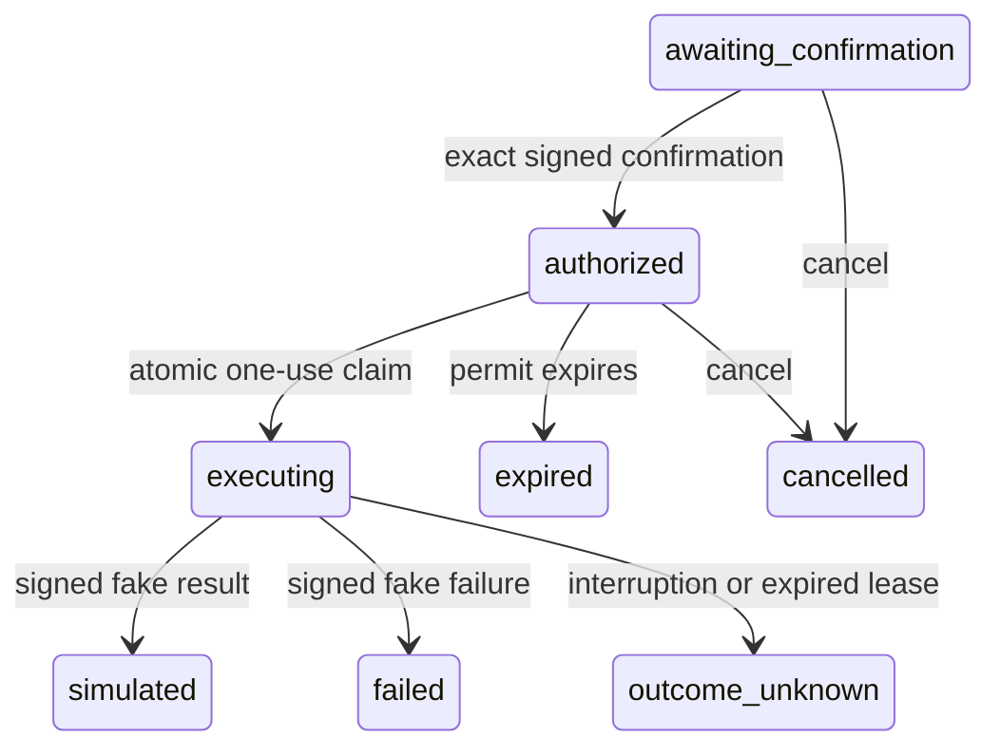

# Phase 2: shared core and simulation authorization

Source work authorized after Phase 1A, starting from `6ea0a6ce4bc9a3aa0ce9ddcb22c8c40a5022524c`. This is an internal simulation foundation. No assistant UI, voice capture, cloud provider, deployment or actual device effects are enabled. Phase 1A physical-device and operational checks remain open.

## What is implemented

- `backend/app/schemas/assistant.py` owns strict, versioned proposals, actions and protocol responses. Unknown fields, arbitrary tools, URLs, private text, scripts, invalid ranges and cyclic/forward dependencies are rejected. Generated TypeScript contracts serve both clients and the shared package.
- `packages/assistant-core` contains the deterministic command parser, runtime validator, local policy checks, bounded injected planner interface, fixed API route builder, state descriptions and simulation runner. It has no dependencies, OS API or network implementation. Each app installs it through a local `file:` dependency; the repository remains separate packages. Metro watches the shared folder and Vite permits that folder explicitly.
- The server independently checks a compiled capability registry, ownership, device/platform, policy version, expiry, signatures, revisions and permit consumption. Client flags and planner output grant no authority.
- The additive v2 SQL migration stores simulation sessions, tasks, actions, challenges, hashed permits and minimal events. All state changes use the existing write-transaction adapter. Idempotent creation and permit claims serialize under SQLite/Turso write transactions; uncertain commits are never retried by this protocol.
- Android and iOS contain a native simulation validator and confirmation skeleton: compiled ranges/catalog, exact action description, foreground/unlock and enrolled-key binding, signature over the immutable server envelope, and one-use in-memory approvals for claim/receipt signing. These native additions have not been compiled or exercised on hardware.

Pydantic discriminated unions drive the action contract. The generator explicitly supports `oneOf` and checks semantic TypeScript declarations rather than rewriting older chat contracts for formatting. [Pydantic unions](https://docs.pydantic.dev/latest/concepts/unions/). SQLite's immediate transaction acquires write authority before application reads. [SQLite transactions](https://www.sqlite.org/lang_transaction.html). Native async functions use Expo's main-queue module bridge for confirmation UI. [Expo module API](https://docs.expo.dev/modules/module-api/).

## Scope and limits

| Capability prototype | Platforms               | Allowed argument          | Current effect  |
| -------------------- | ----------------------- | ------------------------- | --------------- |
| `media_volume.set`   | Android                 | Integer percentage 0–70   | Pure simulation |
| `brightness.set_app` | Android/iOS             | Integer percentage 10–100 | Pure simulation |
| `application.open`   | Web/Android/iOS catalog | `spotify` or `clock`      | Pure simulation |

Every prototype requires exact transaction confirmation. The website can parse/preview supported commands locally; its management cookie cannot obtain a phone's simulation authority. Catalog availability does not imply a working platform adapter. Only an enrolled native device can mint the simulation scope. No new Android permissions, URL schemes, native OS execution functions or browser handoffs are added.

Examples: `set volume to 50%`, `brightness to 40 percent`, `open spotify`, or up to five explicit commands joined with `then`. Negations, quoted instructions, retrieved text and unsupported commands require clarification. Proposals contain only typed public numeric/catalog values, not the original command. Reminders, personal text, schedules, contacts and communication are intentionally absent until encrypted private-state and capability-specific gates are met.

`planWithProvider` is an injected port tested with fake providers. It requires explicit external-processing consent and user-originated input, allows at most two attempts including one schema repair, caps input at 1,024 characters/output at 8 KiB and enforces a maximum 30-second deadline. No repository chat/RAG provider is connected. Processor/region/retention/spend approval remains required before enabling a real provider.

## Authorization flow

1. A current native `security:manage` session requests `POST /api/v1/assistant/simulation/sessions`. The result has only `assistant:simulate` scope and is held in memory by a future caller. Ordinary account, management and simulation credentials cannot substitute for one another. The child's maximum lifetime is 15 minutes and never exceeds its management parent; parent logout, password change, expiry and device revocation invalidate it.
2. `POST /simulation/tasks` receives a caller-created idempotency key and validated proposal. The key is scoped to account and device; identical retry returns the same task, different arguments conflict. There are at most five steps; this MVP deliberately executes them sequentially, even if explicit dependencies would allow parallel work. Never derive an idempotency key from model text.
3. `/authorization-challenge` snapshots account, installation, enrolled key, API origin, session hash, policy/protocol versions, task/action/revision, canonical arguments and their digest, expiry and a fresh nonce. Native confirmation displays the exact simulation action and signs these bytes only after approval.
4. `/authorize` consumes that proof once and issues a 60-second, hashed-at-rest, single-use permit plus a claim challenge bound to its hash. Native signing requires the earlier approved snapshot and next revision.
5. `/claim` atomically consumes the permit and records a 15-second claim lease. Only after receiving this acknowledgement may the runner invoke the fake executor. Lost acknowledgement means no invocation. The runner also rechecks local foreground/unlock/consent/permission flags before each sensitive transition; these are supplementary to native and server checks.
6. A signed receipt binds the next revision, claim and `simulated`, `failed` or `outcome_unknown` outcome. The runner bounds an injected simulation executor by the claim deadline. `simulated` is always described as having performed no device action.



Task reads reconcile expired leases, so process restarts cannot silently reset a claim. No worker or automatic effect retry is introduced. Cancellation before claim cancels pending work; cancellation after claim reports unknown. Failure/unknown/expiry cancels later pending steps. Receipts after lease expiry are rejected. Native source clears in-memory approvals on background/teardown and cancels pending dialogs on background, expiry or key deletion. A native restart loses its in-memory simulation approval; the durable server claim can only become unknown, never replay. These lifecycle paths still require compilation and device verification. Real executors require a separately reviewed durable native ledger and result-evidence design before integration.

## Persistence and budgets

Opaque session/permit secrets are never stored raw. Challenge payloads bind their hashes and public key; they contain no raw command, audio, transcript or private capability argument. The event API exposes IDs, state and timestamp only. Inputs are parameterized SQL, HTTPS-bound, feature-gated and covered by existing assistant body/content-type/query/cache protections.

Internal simulation limits: eight active sessions/account, ten session creations/minute, sixty ledger operations/minute/account and one hundred task allocations/day/account. Pending tasks expire after 15 minutes. Task allocation deletes at most one hundred histories older than seven days, with cascades, per request. Thus cleanup is opportunistic rather than a guaranteed deletion deadline; deployments without new allocations retain rows until a separately approved purge. This simulation-only policy is not a legal retention promise or a substitute for D8 approval. Add encryption/key lifecycle and approved deletion/backup procedures before storing private arguments or opening public access.

## Integration and release gates

`frontend/src/services/assistant.ts` and `mobile/src/services/assistant.ts` expose the shared core for later UI work. Transport creation requires an explicitly supplied, same-origin simulation-scoped request port; it does not reuse chat auth or automatically send proposals. The mobile adapter delegates confirmation/signing to the native simulation methods. Existing chat responses/SSE never enter this pipeline and no existing screen starts simulations.

Both feature flags default to false: `ASSISTANT_SECURITY_ENABLED` and `ASSISTANT_SIMULATION_ENABLED`. Enabling simulation without security is invalid configuration. Keep them disabled until the corresponding gates pass. Neither flag enables an OS executor.

Mobile app/package versions move from 1.2.0 to 1.3.0 because the native module API changed and runtime version follows app version. Existing binaries do not receive these native methods through OTA. No EAS build, upload, OTA, migration of configured data or deployment was run. Validate the local package is included in the build context when native packaging is eventually authorized.

Before declaring Phase 2's native gate complete: compile/autolink both platforms; exercise foreground/lock/background/dialog dismissal/restore and exact native-policy conformance using synthetic accounts; verify snapshots cannot change between confirmation/claim; and review signing/secure-storage/logging behavior on supported hardware. Then complete Phase 1A's deferred device checks. Voice and real low-risk adapters remain later phases, with capability-specific permission, cancellation and evidence checks.

## Reproducible offline checks

From repository root, with already-installed dependencies:

```powershell
backend/venv/Scripts/python.exe -B backend/tests/test_assistant_core.py
backend/venv/Scripts/python.exe -B backend/tests/test_assistant_security.py
backend/venv/Scripts/python.exe -B backend/tests/test_configuration.py
backend/venv/Scripts/python.exe -B backend/tests/test_api_contracts.py
backend/venv/Scripts/python.exe -B scripts/generate_api_contracts.py --check
node tests/assistant_core.test.cjs
node tests/assistant_security_clients.test.cjs
node frontend/node_modules/typescript/bin/tsc --project frontend/tsconfig.json --noEmit --incremental false
node mobile/node_modules/typescript/bin/tsc --project mobile/tsconfig.json --noEmit --incremental false
```

The Python protocol tests install the existing synthetic configuration/provider stubs before importing the application and use disposable databases plus a loopback Turso HTTP fixture. They test server/software-key protocol behavior, not secure hardware, production Turso or actual device execution. Evidence and remaining gates are tracked in [the checkpoint](phase-2-progress.md).
